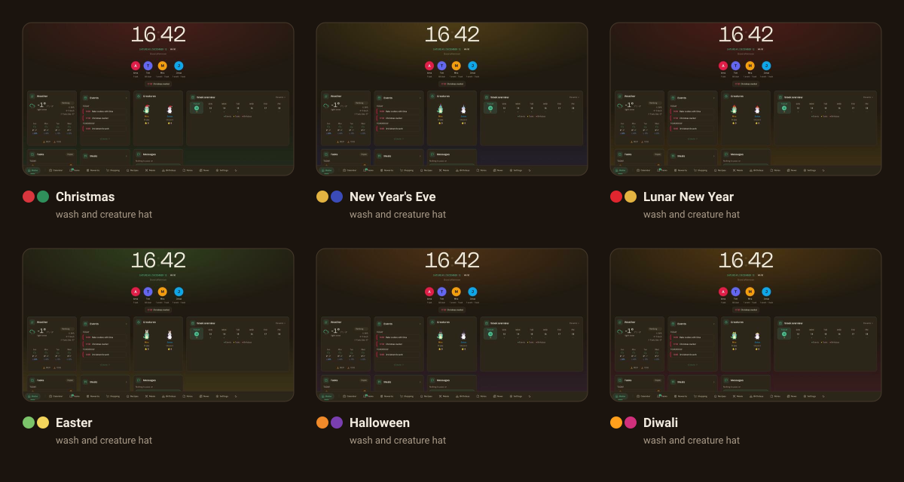
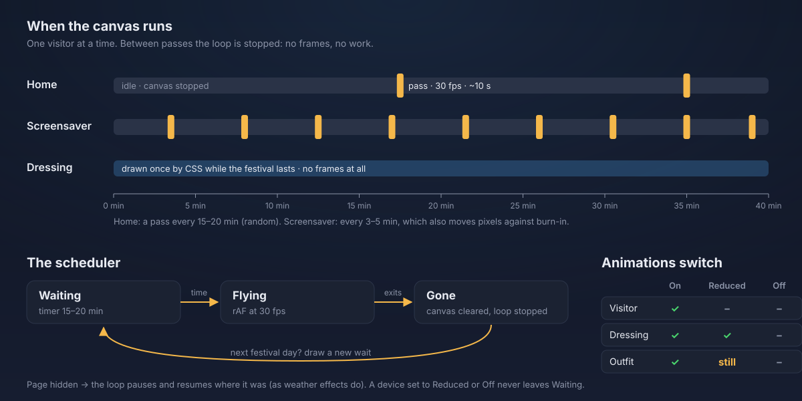
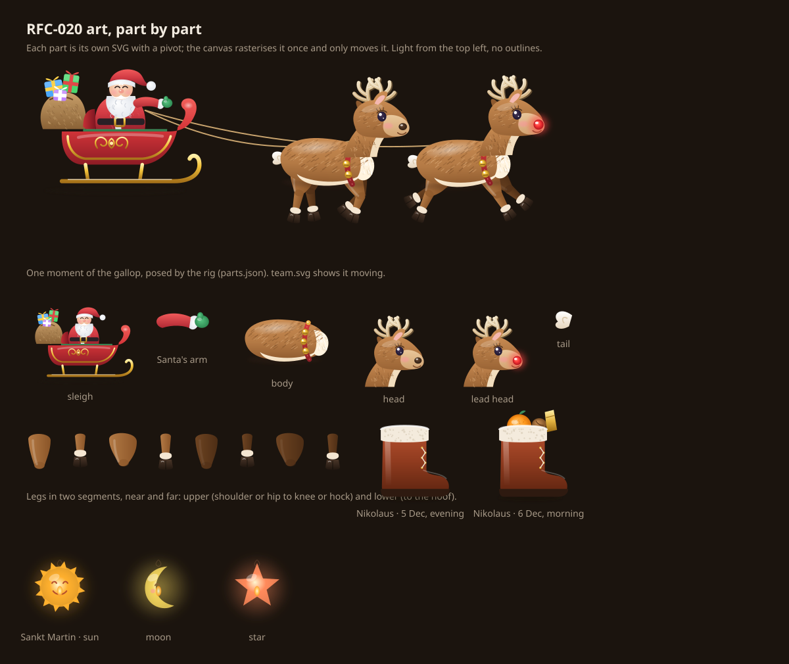

# RFC-020 — Festival decorations on Home and the screensaver

| | |
|---|---|
| **Status** | Idea with a feasibility study; the owner's decisions are in (§8). Nothing built |
| **Date** | 2026-11-01 |
| **Depends on** | the Animations switch (#421), weather effects (#420, #429), the colour wash (#422), holiday regions (RFC-014), drawn creatures and the creature shop (RFC-016, RFC-017) |

## 1. Why

The weather effects showed that a wall display that changes with the world
outside is something families notice and like. Festivals are the other thing
that changes the feel of a house: in December the kitchen has an Advent
wreath, in October the kids carve pumpkins. Kinboard knows the date, the
family's holiday region and, since #421, how much each screen may move. It
can join in:

- **Santa's sleigh** flying over Home and the screensaver every couple of
  minutes in Advent. Tap it, and presents and stars come down.
- **Decorations on the widgets**: snow on each card's top edge at Christmas,
  lanterns for Lunar New Year, a pumpkin at Halloween.
- **The children's creatures** wearing a Santa hat, bunny ears or a witch's
  hat.
- **The colour wash** turning festive: Christmas red from the top, pine green
  from the bottom.

**Verdict: feasible, and mostly an artwork job.** The layer it needs (a
non-interactive canvas, capped at 30 frames a second, paused when hidden,
obeying the Animations switch) already exists as
`components/weather-effects.tsx`. The creatures already have slots for things
to wear (RFC-017's shop), and the colour wash is one CSS rule. The dates for
every festival in §3 can be worked out in the browser without a network call,
Diwali excepted (§3.2). The cost is drawing each scene well, the same kind of
work RFC-016's creatures were.



*The mockups are built on screenshots of Kinboard itself: a throwaway
household on a local stack, at 1080p, with the weather stubbed and the clock
set to a Saturday in Advent (`020/capture.cjs`). The snow, lights, sleigh and
presents are drawn over the measured card positions (`020/mockups.py`). The
colour wash and the creatures' hats are not drawn over the screenshot: they
are the real CSS and the real creatures, with the festival item swapped into
the creature's head slot. The sleigh, snow and flames are animated in a
browser and stop when the viewer asks for reduced motion.*

## 2. What it looks like

Four layers. A festival can use any of them.

| Layer | What | Moves? | Where |
|---|---|---|---|
| **Visitor** | Something flies over the screen: the sleigh with reindeer, the Easter bunny, bats, lanterns, fireworks at the family's midnight. A tap on it drops presents and stars | ~10 s per pass, **every 2 minutes** | Home and the screensaver, **over the widgets** |
| **Dressing** | Still decorations on the widget cards: snow, lights, bunting, lanterns, a pumpkin, diyas | no | Home's widget grid |
| **Outfit** | A festival item in the creature's head slot | the creature's own idle loop | wherever a creature is drawn |
| **Colour wash** | The month's wash (#422) in two festival colours instead | no | every page |

### 2.1 Visitors



**Over the widgets, every 2 minutes.** A pass takes about ten seconds, so the
canvas runs about 8% of the time and is stopped in between: no frames, no
work. Each pass takes a slightly different path, so it never parks over the
same card twice in a row. On the screensaver the same rhythm also moves
pixels against burn-in, alongside the existing shift (`BURN_IN_OFFSETS`).

**A tap does something.** Tapping the visitor drops presents and a shower of
stars, and the creatures on that screen cheer, reusing their live reaction
(#367). Only the visitor's own shape catches the tap: one transparent button
that moves with the sprite. A tap anywhere else reaches the widget beneath as
always. After one tap the visitor stops catching taps for the rest of its
pass, so a tap meant for the Events card that lands on the sleigh costs one
surprise, not a stuck screen.

**With the weather, never instead of it.** When the weather effects are on,
a festival never switches them off or takes their place. The two make one
scene:

- **One wind.** The weather's gust (`gust` in `EffectsCanvas`, 0 when calm, up
  to 2 in a storm) also pushes the visitor. The sleigh drifts and banks with
  the snow, lanterns swing, and the bunny's ears blow back.
- **Depth.** Snow and rain keep falling behind the widgets, as now. While a
  visitor passes, a few flakes or drops fall in front of it too, so it flies
  *through* the weather instead of over a picture of it.
- **Light and air.** In fog a visitor fades in and out of the haze. In a storm
  it's darker, lit by the lightning's glow. In heat the sun's glare sits over
  it as over everything else.
- **Dressing and weather.** The snow caps on the cards stay a still
  decoration. Real snowfall doesn't pile them higher, because a growing
  decoration would be motion that never stops.



### 2.2 Dressing


**Dressing never covers content.** It sits on a card's border and corners, in
the padding, never over text or a control. It is checked at 320 px, on a wall
display, and in WebKit, because Chromium alone has missed layout bugs here
before.

### 2.3 Outfits: a festival item in the shop's slots


RFC-017's creature shop already gives every creature four slots (head, face,
neck, background), with each item drawn once in a head-sized space and
placed on every species by `onHead()`. A festival outfit is **one more item
per festival in the head slot**, drawn the same way. The hats in the mockup
are exactly that: the shop's cap swapped for a festival hat inside the real
component, on the real Drake and Unicorn.

- During the festival, the festival item is worn instead of the child's own
  head item. The child's own item comes back the day after.
- A child can switch festival outfits off for their own creature (a kid-side
  field, like `style` and `look`).
- Festival items are not for sale and cost no points.

### 2.4 Colour wash



Today the wash is one colour, the month's (`--month-primary`), glowing from
the top and rising from the bottom (`body::before` in `globals.css`). During
a festival it takes **two colours**, one for the top and one for the bottom,
at **the same strength** as the month's wash today (14% and 10% in dark mode),
so contrast doesn't change. The screenshots above are the real rule with
those two colours set. It is colour, not motion, so it stays on every
Animations setting, as the month's wash does now.

When two festivals overlap (Hanukkah during Advent, New Year's Eve on
Christmas's last days), **the shorter one wins on its own days**: it sets the
wash, the dressing and the visitor, and the longer one comes back after.

## 3. Which festivals, and where the dates come from

"Worldwide" can't mean "the family's region". The 38 regions Kinboard offers
(RFC-014) are almost all European, plus US, MX, BR and ZA, and the bundled
holiday data has no Lunar New Year, Diwali or Hanukkah. A family in Hamburg
may celebrate Eid, and a family in Texas may celebrate Lunar New Year. So the
festivals are **chosen by the family** (§4). Their dates come from a small
module of their own, `lib/festivals.ts`, not from the region data.

### 3.1 The festivals, their dates, and where they are pre-ticked

The owner's rule: **pre-tick the festivals that are common in the family's
country.** The last column is that rule, as a table `lib/festivals.ts` keeps
per offered country. It is reviewed whenever a region is added.

| Festival | Decorated | Date from | Pre-ticked in |
|---|---|---|---|
| Christmas | 1st Advent → 6 Jan | fixed | all 38 |
| New Year's Eve | 31 Dec, fireworks at the family's midnight | fixed | all 38 |
| Easter (Western) | Palm Sunday → Easter Monday | Gregorian computus, ~10 lines | all except the five below |
| Easter (Orthodox) | the same week, Julian computus | computus | RS, BG, RO, MD, BY |
| Halloween | 24 → 31 Oct | fixed | US, GB, IE |
| Día de Muertos | 31 Oct → 2 Nov | fixed | MX |
| Thanksgiving | its weekend | 4th Thursday of November | US |
| Carnival | the week up to Shrove Tuesday | Easter − 47 days (Ash Wednesday is − 46) | BR |
| St Nicholas | 5–6 Dec | fixed | NL, BE, LU, DE, AT, CH, CZ, SK, PL |
| St Martin's Day | 11 Nov, from dusk | fixed | DE, NL, AT, CH |
| St Patrick's Day | 17 Mar | fixed | IE |
| Midsummer | its eve and day | per country | SE, EE, LV, LT |
| Lunar New Year | eve → Lantern Festival (15th day) | `Intl` `chinese`, month 1 day 1 (2026-02-17, 2027-02-07 ✓) | — |
| Eid al-Fitr | 3 days | `Intl` `islamic-umalqura`, Shawwal 1 (2026-03-20, 2027-03-09 ✓) | — |
| Eid al-Adha | 4 days | `Intl` `islamic-umalqura`, Dhu al-Hijjah 10 (2026-05-27, 2027-05-16 ✓) | — |
| Hanukkah | 8 nights | `Intl` `hebrew`, Kislev 25 (2026-12-05, 2027-12-25, 2028-12-13 ✓) | — |
| Passover | 8 days | `Intl` `hebrew`, Nisan 15 (2026-04-02, 2027-04-22 ✓) | — |
| Nowruz | the days around Farvardin 1 | `Intl` `persian` (2026-03-21 ✓) | — |
| Diwali | 5 days | **a date table** (§3.2) | — |
| Valentine's Day | 14 Feb | fixed | — |

"—" means it isn't common across any offered country as a whole, so a family
ticks it. A religious or cultural festival is never assumed.

The ✓ dates were computed with `Intl.DateTimeFormat` in Node 22 on
2026-11-01 and checked against published calendars. `Intl` calendars ship
with full ICU, which Chromium (the wall displays and the Pi), Safari and Node
all have. WebKit still needs checking in the spec run, because a missing
calendar there would silently produce no festival rather than an error.

### 3.2 Where it's harder

- **Diwali** follows the Hindu lunisolar calendar, which `Intl` doesn't have:
  its `indian` calendar is the solar Śaka calendar. Diwali needs a table of
  dates (2026–2036 is eleven lines). A spec fails once the table has less
  than two years left in it, so it gets topped up long before it runs out.
- **The Islamic calendar** in `islamic-umalqura` is Saudi Arabia's
  astronomical one. A community that goes by moon sighting can be a day off.
  The windows are several days long, so the decorations are up either way.
- **Midnight on New Year's Eve** is the family's midnight, in the family's
  time zone (the calendar already has one), not the display's or the
  server's.

### 3.3 Festival kits: feasible examples

What each festival could look like in the four layers, and how much drawing
it takes. A festival is **feasible** when two things hold. Its date can be
computed (fixed, Easter-relative, an `Intl` calendar, the region data, or a
short table). And it can be marked festively, without devotional imagery. The
dates added here were checked like the ones in §3.1: Mid-Autumn 2026-09-25
and 2027-09-15, Dragon Boat 2026-06-19 and 2027-06-09, Ramadan from
2026-02-18 and 2027-02-08, Purim 2026-03-03 and 2027-03-23 (Adar II in a leap
year), Sukkot 2026-09-26 and 2027-10-16, Yalda 2026-12-21.

**Effort** counts new drawings: *low* reuses what exists (the shop's items,
shapes already drawn for another festival), *medium* is a few new still
drawings, *high* needs a new animated visitor. Items in `code` are already in
RFC-017's shop.

#### Winter

| Festival | Visitor | Dressing | Outfit | Wash | Date | Effort |
|---|---|---|---|---|---|---|
| **Advent → Christmas** | the sleigh | snow caps; one more candle lit in a card's corner each Advent Sunday | Santa hat, `snow` background | red / pine green | fixed; Advent from 25 Dec | high (the sleigh), then low |
| **St Nicholas** (Nikolaus) | none | on the evening of 5 Dec an empty boot stands by the Tasks card; on the morning of 6 Dec it's filled with an orange, nuts and chocolate | `scarf` | red / gold | fixed | low |
| **Hanukkah** | a dreidel spins across the bottom | a row of eight lights along a card's edge, one more lit each night | knitted blue hat | blue / silver | `Intl` `hebrew`, Kislev 25 | medium |
| **Yalda** | none | pomegranates and a slice of watermelon in a corner | `scarf` | deep red / night blue | `Intl` `persian`, Azar 30 | low |
| **New Year's Eve** | fireworks over the clock at the family's midnight | confetti at the cards' corners | party hat, `star_glasses` | gold / midnight blue | fixed | medium |
| **Three Kings** (ES, MX) | three crowns parade along the bottom | a ring cake in a corner | crown | gold / purple | fixed, 6 Jan | low |
| **Orthodox Christmas** | the sleigh | snow caps | Santa hat | red / pine green | fixed, 7 Jan (Julian 25 Dec) | low (reuses Christmas) |
| **Lunar New Year** (Seollal, Tết) | a dragon dance along the bottom; lanterns rise on the last day | red lanterns on the cards | red cap with a lantern | red / gold | `Intl` `chinese` (`dangi` for Seollal), month 1 day 1 → day 15 | high (the dragon) |

#### Spring

| Festival | Visitor | Dressing | Outfit | Wash | Date | Effort |
|---|---|---|---|---|---|---|
| **Valentine's Day** | hearts float up from the bottom | none | `heart_glasses` | rose / pink | fixed | low |
| **Carnival** | streamers and confetti burst from the corners | paper streamers on the cards | a jester's hat or mask | purple / green / gold | Easter − 47 days, Shrove Tuesday | medium |
| **Ramadan** | none | lanterns on the cards, **after sunset only** (from the weather data; from 18:00 without it) | none | night blue / gold | `Intl` `islamic-umalqura`, month 9 | low |
| **Eid al-Fitr, Eid al-Adha** | lanterns and sparkles drift up | string lights and lanterns on the cards | a festive cap with a tassel | emerald / gold | `Intl` `islamic-umalqura` | medium |
| **Purim** | noisemakers and masks tumble across | masks hanging from the cards | a mask (face slot) | purple / gold | `Intl` `hebrew`, Adar (Adar II) 14 | medium |
| **Holi** | clouds of coloured powder burst over the widgets | colour splashes at the cards' corners | colour-splashed face | many colours | **a date table**, like Diwali | medium |
| **St Patrick's Day** | a rainbow arcs over the widgets | shamrocks at the corners | green top hat, `rainbow` background | green / gold | fixed | low |
| **Nowruz** | goldfish swim along the bottom | sprouting grass along a card's bottom edge | `flower_crown` | spring green / turquoise | `Intl` `persian`, Farvardin 1 | medium |
| **Passover** | none | spring blossoms on a card's corner | none | spring green / wine red | `Intl` `hebrew`, Nisan 15 | low |
| **Easter** (Western, Orthodox) | the bunny hops along the widgets | bunting; eggs in a corner | bunny ears | spring green / yellow | computus | medium |
| **King's Day** (NL) | orange balloons rise | orange bunting | crown | orange / blue | region data (27 Apr, moved off Sunday) | low |
| **Mother's Day / Father's Day** | flowers bloom up from the bottom | none | `flower_crown` / `bow_tie` | the family's choice | region data where it has the day (the curated countries), else a per-country rule (2nd Sunday of May, …) | low |

#### Summer

| Festival | Visitor | Dressing | Outfit | Wash | Date | Effort |
|---|---|---|---|---|---|---|
| **Dragon Boat** | a dragon boat paddles along the bottom | none | none | green / red | `Intl` `chinese`, month 5 day 5 | medium |
| **Midsummer** (SE, EE, LV, LT) | none; it's light all night | flower garlands on the cards | `flower_crown` | light green / yellow | per country (eve on a fixed date or the Friday between 19 and 25 Jun) | low |
| **National days** (US 4 July, FR 14 July, CH 1 Aug, …) | fireworks over the clock in the evening | bunting in the flag's colours | `medal` | the flag's colours | region data: the region's national holiday | medium |

#### Autumn

| Festival | Visitor | Dressing | Outfit | Wash | Date | Effort |
|---|---|---|---|---|---|---|
| **Mid-Autumn** | lanterns drift past a full moon | a rabbit and mooncakes in a corner | none | gold / night blue | `Intl` `chinese`, month 8 day 15 | medium |
| **Sukkot** | autumn leaves drift down | fruit and leaves hanging from the cards | none | harvest gold / green | `Intl` `hebrew`, Tishri 15 | medium |
| **Diwali** | sky lanterns rise; diyas light along the cards | marigold garlands, diyas | marigold garland | saffron / magenta | **a date table** | medium |
| **Halloween** | bats out of a corner | a cobweb, a pumpkin | `wizard_hat` | orange / purple | fixed | low |
| **Día de Muertos** | marigold petals drift down | papel picado bunting | a marigold crown | marigold / magenta | fixed | medium |
| **St Martin's Day** (Sankt Martin; DE, NL, AT, CH) | the lantern walk: children's paper lanterns (sun, moon, star) bob along the bottom at dusk | paper lanterns hanging from the cards from dusk | a paper lantern beside the creature (background slot) | amber / night blue | fixed, 11 Nov; from sunset (weather data; 17:00 without it) | medium |
| **Thanksgiving** (US) | autumn leaves blow across | leaves and a pie in a corner | leaf crown | amber / brown | 4th Thursday of November | low |

#### Left out, and why

- **Solemn days**: Good Friday, Yom Kippur, Ashura, All Souls' Day,
  Totensonntag, Remembrance and Memorial days. A sleigh-style visitor is
  wrong for a day of mourning or fasting. The colour wash already follows
  the month on those days, and that's enough.
- **Mawlid** and **Vesak**: their observance differs a lot between
  communities, and Vesak's date between traditions. Possible later with a
  table per tradition, if a family asks.
- **Rosh Hashanah**: feasible (`Intl` `hebrew`, Tishri 1; apples and honey in
  a corner). It's left for a family to ask for, because it opens the solemn
  Days of Awe that end with Yom Kippur.

## 4. Who chooses, and how much moves

- **The family chooses its festivals** under Settings → Design →
  *Festivals*. The list starts with the country's common festivals ticked
  (§3.1); everything else is one tick away. One switch turns all of it off.
- **Each screen's Animations switch decides how much of it moves**, as with
  the weather:
  - **On:** everything.
  - **Reduced:** dressing, outfits (still) and the colour wash; no visitors.
  - **Off:** the colour wash only, as the month's wash today. No visitors,
    no dressing, no idle loop.
- **Preview**, as for the weather: `/?festival-preview=christmas` on Home,
  and a *Preview* button per festival in settings, so a scene can be checked
  in July without changing the clock.

## 5. How it would be built



All of it is drawn in code, so the artwork belongs to Kinboard (as RFC-016
decided for the creatures). There are no asset packs to licence and nothing
to fetch, which matters on LAN-only installs.

| Piece | Reuses | New |
|---|---|---|
| `lib/festivals.ts` (pure): `festivalDates(id, year)`, `activeFestival(date, chosen, timeZone)`, `commonFestivals(country)` | the holiday region, the family time zone | the date rules and the pre-tick table in §3, the Diwali table, the overlap rule (§2.4). Fast-suite spec with the dates above |
| A `festivals` family setting (chosen list, on/off) | `useSetting`, `SETTINGS_KEYS`, re-read every minute like the weather effects (#429) | a key and a settings section in en/de/fr |
| Visitors | the `EffectsCanvas` loop: `FRAME_MS`, `devicePixelRatio` capped at 1.5, `visibilitychange`, `useMotion()`, sprites drawn once | the weather's loop is split into a **scene**: one clock, one wind and one light, drawing the weather's layer behind the widgets and a front layer above them (`pointer-events: none`) for the visitor and the flakes in front of it. A 2-minute scheduler adds a visitor to the scene for one pass. With no weather showing, the loop runs only during that pass. One transparent button follows the sprite and takes the tap |
| The tap | the creatures' live reaction (#367) | presents and stars on the canvas |
| Dressing | `<html data-motion>`, set before first paint; same idea | `<html data-festival="christmas">`, plus CSS in `globals.css` on Home's widget grid (one hook on the grid, so none of the widgets changes) |
| Outfits | RFC-017's head slot, `onHead()`, `items.tsx` | one head item per festival; a kid-side switch to opt out |
| Colour wash | `body::before` and its opacities (#422) | `--festival-top` and `--festival-bottom`, set with `data-festival`; the month's colour when unset |
| Screensaver | `components/screensaver.tsx` layers | the visitor canvas above the photo, below the clock |

Weather and festival share that one loop rather than running two side by
side. Two loops would each wake the Pi 30 times a second and could never
agree on the wind (§2.1). Only one visitor flies at a time, and its sprites
are cached, so a pass on a snowy day should cost close to the snow alone.
That has to be measured on the Pi in step 1, not assumed.

### 5.1 The art: drawn in SVG, flown as sprites

Everything should carry as much detail as the drawing can hold: shading,
highlights, fur and fabric, a reindeer's legs that really gallop. **SVG is the
right way to draw it, but not the right way to animate it.** Animating a
detailed SVG means changing hundreds of nodes every frame, and the browser
lays out and repaints them all, filters and gradients included. That's
what a Pi can't afford.

| | Detail | Cost per frame | Fits Kinboard | Verdict |
|---|---|---|---|---|
| **SVG drawn once into sprites, moved on the canvas** | everything SVG can draw: gradients, layered shading, highlights, fine strokes | a few `drawImage` calls, whatever the detail | the weather effects already work this way; the art stays code, as in RFC-016 | **use this for visitors** |
| SVG animated in the DOM (CSS or SMIL) | the same | grows with the drawing; filters and gradients repaint | simple; it's how the mockups move | **use for still or slow parts**: dressing, outfits |
| WebGL (raw, or a library like PixiJS, a few hundred KB) | shaders: real glow, light, thousands of particles | low on a good GPU; the Pi's GPU and drivers vary | a second renderer next to the weather's canvas | not for one sleigh; reconsider if the scene ever needs real lighting |
| Lottie / Rive | rich, keyframed or rigged animation | a runtime (Lottie, a few hundred KB of JS; Rive, a WASM renderer) | artwork made in an outside editor (After Effects, the Rive editor), not in code | no: the art would leave the repo's hands |
| Sprite sheets, animated WebP/AVIF | fixed by the frames | low | fixed resolution; large files; no wind, no depth | no |

So a visitor is **drawn as detailed SVG**, part by part: the sleigh body, each
reindeer's body, head and four legs, Santa, the reins. Each part is rendered
once to an `ImageBitmap` at the screen's pixel ratio. Each frame then only
moves, rotates and layers those parts on the canvas: a gallop cycle for the
legs, a head bob, the reins following, the whole thing banking in the wind.
The detail is paid for once, when the festival starts, not 30 times a
second. Glows, such as the red nose or a lantern's light, are drawn into the
sprite too, because live canvas blur is slow on a Pi.

**One visual language.** Visitors, dressing and outfits use the palette and
the soft, round shapes of RFC-016's creatures, with *Storybook*'s gradients,
soft shadows and highlights for depth, and the same light from the top left.
That way the sleigh belongs to the same world as the Drake and the Unicorn.
There are no outlines, so the art reads the same on dark and light themes.

**Natural movement.** A part that only swings at one joint looks wooden, so
the rig has the joints a body has:

- **Legs in two segments.** Shoulder to knee and knee to hoof at the front;
  hip to hock and hock to hoof behind.
- **A gallop as curves, not poses.** Every joint follows its own smooth
  periodic curve through keyframes (Catmull-Rom, in `art/parts.json`). The
  front knees fold to tuck the hooves back on the lift, then reach out
  extended. The hocks drive back extended, then fold to swing through. Front
  reach meets hind drive, so the team alternates between stretched and
  gathered, as a gallop does, instead of trotting on the spot.
- **The rest follows the legs.** The body pitches and rises once a stride,
  the head counters the pitch to stay level, the tail flicks twice a stride,
  and the second reindeer runs out of step with the first. The sleigh rides
  the stride with a lag, and Santa's arm moves with the reins.
- **Secondary motion.** The whole team banks with its path and drifts in the
  weather's gust (§2.1). The reins are drawn live between the hands and the
  rings, so they sag and tighten. The Sankt Martin lanterns bob with each
  step and swing behind it like a pendulum, each child a little out of step.





### 5.2 Groundwork already in this PR

Not product code, but enough that step 1 starts from drawn, rigged and
measured art rather than from a blank page:



| What | Where | What it gives step 1 |
|---|---|---|
| **The art, part by part** | `020/art/*.svg`, from `020/art.py` | the sleigh, Santa and his arm; a reindeer as body, head (plain and the lead's glowing nose), tail and eight leg segments (near and far); Nikolaus's boot, empty and filled; Sankt Martin's sun, moon and star lanterns. Each in its own coordinates with a pivot |
| **The rig and the gait** | `020/art/parts.json` | where each part sits on its parent, and the gallop and lantern swing as keyframed curves. The canvas and the mockups read the same file |
| **Moving references** | `020/art/team.svg`, `020/art/lanterns.svg`, `020/art/sheet.svg` | the motion, viewable in any browser or on GitHub, and every part laid out |
| **The pipeline, running** | `020/prototype/scene.html`, from `020/bench.py` | §5.1 end to end: parts rasterised once to `ImageBitmap`s, rigged on a canvas at 30 fps, reins live, snow behind and in front, one shared wind. It is also the Pi benchmark (§7.1) |
| **Mockups on the real app** | `020/capture.cjs`, `020/mockups.py` | screenshots of Kinboard with the festival layers placed on measured card positions |

What step 1 still has to build: `lib/festivals.ts` and its specs, the
setting, `data-festival`, the colour wash, the scene in
`components/weather-effects.tsx`, the tap target, and the outfits in
`items.tsx`. The art is drawn to be ported as it is: each part becomes a
string or a component the loop rasterises.

## 6. Steps

| Step | What | When it's worth having |
|---|---|---|
| 1 | `lib/festivals.ts` with all dates, the pre-tick table and specs; the setting; `data-festival`; the colour wash; **Christmas**: the sleigh with its tap (art, rig and gait already drawn, §5.2), snow-capped cards, the Santa hat | before the 1st of Advent, **29 Nov 2026** |
| 2 | **Germany: Nikolaus and Sankt Martin** (decision 7). Nikolaus is low effort and can follow step 1 in time for 6 Dec 2026. Sankt Martin needs its lantern walk drawn | Nikolaus **6 Dec 2026**; Sankt Martin **11 Nov 2027** (2026 only if the work starts in the first week of November) |
| 3 | New Year's Eve: fireworks at the family's midnight | 31 Dec 2026 |
| 4 | Lunar New Year, Easter (Western and Orthodox) | 17 Feb 2027 / Mar–Apr 2027 |
| 5 | The rest of §3.1 and the kits in §3.3, low effort first, as each one's artwork is ready | through 2027 |

Step 1 is small in code and large in drawing. If the sleigh isn't good enough
by mid-November, the wash, the snow-capped cards and the hat can ship alone,
and the sleigh can follow in December.

## 7. Risks

- **Over the widgets.** For ten seconds in every 120, part of a row of cards
  is behind the sleigh. The varying path and the one-tap rule (§2.1) keep it
  from being in the way. If it still is in daily use, slowing the rhythm on
  Home is a one-number change.
- **Taste.** A decoration that looks cheap is worse than none. Every scene
  should be tried on the maintainer's devices before it ships, as the
  creatures were.
- **Cultural care.** Only what's common in the family's country is
  pre-ticked, and everything else is the family's choice. Imagery stays
  festive rather than devotional: lights, lanterns, food and animals, no
  religious symbols.
- **The Pi.** Weather effects already run on it at 30 frames a second. One
  shared loop, one visitor at a time, detailed art paid for once as sprites,
  and a stopped loop between passes keep this in the same budget, but it
  needs measuring (step 1). That means a snowy day with the sleigh passing
  on a real Pi, not a laptop.
- **Sprite memory.** A detailed sleigh at 1.5× on a 1080p wall is on the
  order of a megabyte or two of bitmaps. They are made when the festival starts and released
  when it ends, never for festivals that aren't on.
- **Keeping it fresh.** The Diwali table needs a reminder that fails in time
  (§3.2). Every other date is computed.

### 7.1 Pi performance: what we know, and what we don't

Nobody on the project has a spare Raspberry Pi, so the first numbers are an
**estimate**. They come from `020/prototype/scene.html` (§5.2) in headless
Chromium 147 on a 4-core i5-13400 VM, at 1920×1080, with the CPU throttled.
Each scene ran 20 s after a 2 s warm-up, at Kinboard's 30 fps cap, with 160
flakes behind the widgets and 36 in front. To be harsh, the sleigh flies
**continuously** here; in use it flies 10 s in every 120.

| CPU throttle | Snow only (today) | Snow + sleigh, cached images (§5.1) | Snow + sleigh, live SVG |
|---|---|---|---|
| 1× | 30 fps · 0.3 ms script | 30 fps · 0.6 ms | 30 fps · 0.5 ms |
| 4× | 30 fps · 1.5 ms | 30 fps · 2.3 ms | 29.9 fps · 2.2 ms |
| 6× | 29.9 fps · 1 dropped frame | **28 fps** · 19 dropped · 4.3 ms | **24.2 fps** · 34 dropped · 3.8 ms |

Preparing the images, done once when a festival starts, took 60 ms at 1×,
234 ms at 4× and 391 ms at 6×.

What it says:

- **The cached-image pipeline adds little.** Up to 4× it costs under a
  millisecond of script a frame over snow alone, with no dropped frames.
- **Live SVG falls behind first,** even though its own script time is
  *lower*. Its cost is in the browser's style and repaint work, which a
  script timer doesn't see. That bears out §5.1.
- **At 6× both start dropping frames,** and the drops aren't script: 4.3 ms
  is far inside the 33 ms budget. They're the cost of filling two
  full-screen canvases in software. So step 1 should: clear and redraw only
  the visitor's box on the front layer, not the whole screen; create that
  layer only for a pass; and prepare the images in idle time
  (`requestIdleCallback`), not on the frame that starts the festival.

What it can't say:

- **This isn't a Pi.** DevTools throttling slows only the page's main thread.
  Rasterising and compositing still run at this CPU's speed. Headless
  Chromium here draws through SwiftShader, in software, while a Pi has a
  real GPU with drivers of varying quality. Very roughly, a Pi 4's cores
  are 5–7× slower than this one single-threaded, and a Pi 5's 2.5–3×, so
  4× and 6× bracket them. That's an educated guess, not a measurement.
- **It's not the whole app.** Kinboard itself, with React, realtime and the
  widgets, runs alongside on a real display; the benchmark has a screenshot
  of Home as its backdrop.

**Real numbers, from people who have a Pi.** `scene.html` is a single file
with no server and no network, so anyone with a Pi wall display can run it:

```bash
# from main once this RFC is merged; until then, replace main with docs/rfc-holiday-decorations
curl -LO https://raw.githubusercontent.com/svenger87/kinboard/main/docs/rfc/020/prototype/scene.html
chromium scene.html          # or open it in the kiosk browser
```

It runs about 70 s and ends with a table and a *Copy results* button. The
JSON it copies has the browser, cores, memory, screen and pixel ratio, so
reports from different Pis can be compared. **Proposed:** step 1 waits for
numbers from at least a Pi 4 and a Pi 5.

## 8. Decisions (owner, 2026-11-01)

1. **Visitors fly over the widgets**, not behind them. The tap target and the
   one-tap rule in §2.1 follow from this.
2. **Every 2 minutes**, on Home and on the screensaver.
3. **Pre-tick the festivals common in the family's country** (§3.1).
4. **A tap on the visitor does something**: presents and stars, and the
   creatures cheer.
5. **Nothing on birthdays.**
6. **The colour wash changes** with the festival (§2.4).
7. **Sankt Martin and Nikolaus come next, for Germany**, right after step 1 (§6).
8. **Never replace the weather effects; melt together** with them (§2.1, one loop in §5).
9. **As much detail as the drawing can hold** (§5.1): drawn in SVG, flown as sprites.

## 9. Not in this RFC

- Birthdays (decision 5).
- Sounds. A wall display that jingles is a different decision.
- Decorations a family uploads or draws itself.
