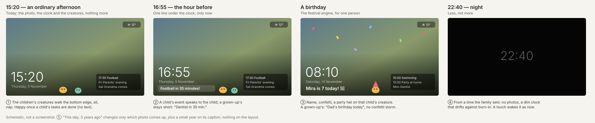

# RFC-021 — The idle screen: a picture frame that speaks when it matters

| | |
|---|---|
| **Status** | Idea; the owner's decisions are open (§8). Parts already shipped elsewhere (§3.0) |
| **Date** | 2026-11-05, revised 2026-11-10 after 1.15.0 |
| **Depends on** | drawn creatures and their moods (RFC-016, RFC-017, `lib/creature-mood.ts`), creatures on Home and the family bedtime (#447), the festival engine (RFC-020), the Animations switch (#421), the screensaver's burn-in shift (`BURN_IN_OFFSETS`) |

## 1. Why

The idle screen is the screen a wall display shows most of the day. Today it
answers "what's going on out there": a photo, the clock and date, the
weather, energy and the car, the news, the next three events and four
birthdays, and since RFC-020 a festival's visitor. It says almost nothing
about the people in the house.

What other families have told us, on GitHub:

- **It is a picture frame.** "Wir nutzen den Bildschirm oft als digitalen
  Bilderrahmen", with no motion sensor, so the screen is on all day. They
  didn't want the news on it (now a switch), and wanted the clock and the
  events readable from across the room (now *Large details*). "Wenn man mehr
  will, einfach herantreten und berühren." (Discussion #282)
- **The children are the audience.** Two families asked for things that
  motivate children: points instead of money, the egg hatching, icons on
  tasks for children who can't read yet (#282, #349). #282 also asked for a
  countdown "so the kids know how long it is until Christmas, the trip with
  Grandma or the class trip".

So this RFC adds the household to the idle screen without making it busier.

## 2. The rule: nothing new unless it has something to say

A family looks at the idle screen from three metres away, for a second, on
the way past. Everything in this RFC passes three tests:

1. **The photo stays the main thing.** Nothing new covers its middle.
2. **It disappears when it has nothing to say.** No empty states, no "no
   events", no zero counters. A family without creatures, without a birthday
   today and with nothing in the next hour sees today's idle screen,
   unchanged.
3. **At most one new line of text, and only for a while.** Everything else
   is pictures, movement, or taking things away.

## 3. What it adds

### 3.0 What 1.15.0 already has

Three pieces of this RFC's ground arrived before it was decided, from other
directions:

- **Creatures on Home** (#447, a contributor's PR). Settings → Creatures →
  Creatures on Home, off by default: every child's creature walks along the
  bottom of Home, rests, hops, plays with the others, takes a tap, and lies
  down at bedtime. The rules are `lib/creatures/roam.ts` (pure, tested step
  by step); the drawing is `components/creatures-on-home.tsx`, one transform
  per creature from one animation-frame loop at most 30 times a second. Home
  keeps their strip free, and the loop **stops while the screensaver is up**.
- **A family bedtime** (#447). Settings → Creatures sets *asleep from* and
  *awake at* (`creature_bedtime`, 20:00 to 06:30 unless changed, across
  midnight or within a day). Every creature's sleepy mood follows it.
- **The screensaver's lists** (#453, asked for in #282): 1 to 5 events, and
  birthdays off or 1 to 5.

So §3.1 is now "the same creatures, on the idle screen too", and §3.4's night
starts from the family's bedtime rather than a second clock.

### 3.1 The children's creatures, on the idle screen too

The creatures from Home (§3.0) walk along the bottom edge of the idle screen
as well, below the clock and the events, with the same rules, the same tap
and the same bedtime. Small: about the height of the date line. At most one
creature per child, and only the children's. Building it is mostly moving
the floor: the rules and the drawing exist, and today the Home floor stops
under the screensaver because the screensaver covers it.

- **Its mood is the message.** `lib/creature-mood.ts` already makes a
  creature happy once its child's tasks for today are done, and sleepy in the
  family's night. On the idle screen that's the whole "tasks" feature: a happy
  creature with a small star beside it, no counter, no list. A child sees from
  the doorway that they're done, and so does everyone else. Never sad, as
  the mood rules already say.
- **Festivals come with it.** The creature wears the festival's outfit
  (RFC-020 §2.3), so the idle screen joins in a festival without new art
  and without the dressing RFC-020 kept to Home.
- **Against burn-in.** A slow walker is better against burn-in than anything
  that stands still: it never rests in one place for long.
- **Animations** (#421): as on Home, On walks, Reduced stands still (here
  also shifting with the burn-in offsets), Off shows no creature.
- **A tap** on a creature does what it does on Home (a hop and hearts) and
  doesn't wake the screen; a tap anywhere else wakes it as now.
- **Its own switch.** Creatures on Home and on the idle screen are separate
  switches: a family may want them on the wall all day but not on the
  tablet's Home, or the other way round (§8.3).

### 3.2 The next event, under the clock, in the hour before it

One line under the date, only in the 60 minutes before an event that starts
at a time (not all-day ones): "Football in 35 minutes!". It replaces nothing:
the events list stays where it is. At the start time it goes away.

The wording depends on whose event it is (§4).

### 3.3 A birthday

On a family member's birthday (the birthdays list), the idle screen says so
under the clock all day, with the festival engine's confetti and a party hat
on that child's creature: in effect a festival for one person. A child's
birthday is the big version; a grown-up's is the line alone (§4). Two
birthdays on one day: both names on the line.

### 3.4 Night

During the family's bedtime (§3.0), if the family switches night on under
Settings → Screensaver: no photo, the clock alone, dim, drifting with the
burn-in offsets. No events, and the creatures asleep where they are, as on
Home. A touch wakes the screen as now. One clock for the household, not a
second one for the screen; a family that wants the screen dark longer than
the children sleep is §8.4. For a display in a hallway or a kitchen that is
on all night, this takes the most away and adds nothing.

### 3.5 "This day, n years ago"

When a photo was taken on today's date in an earlier year, it comes up
before the others (the photo bag still shuffles; these go first), with the
year added small to its caption. Nothing else changes. Only uploaded photos
have a date they were taken (`taken_at`); for Unsplash, iCloud and DLNA this
does nothing.

## 4. A child's words and a grown-up's

Kinboard knows who is a child (`people.is_child`, often with a birth date),
whose an event is (`events.person_id`, or the person a calendar belongs to,
`calendars.person_id`), and whose a birthday is (`birthdays.person_id`). The
new lines speak to whoever they are about:

| | A child's | A grown-up's |
|---|---|---|
| The hour before (§3.2) | „Fußball – noch 35 Minuten!" / "Football in 35 minutes!" | „Zahnarzt in 35 Min." / "Dentist in 35 min." |
| Birthday (§3.3) | „Mira wird heute 7! 🎉" / "Mira is 7 today! 🎉" | „Heute: Papas Geburtstag" / "Dad's birthday today" |
| Tasks (§3.1) | the creature, happy, a star | (grown-ups have no creature here) |

A child's line is a whole sentence with an exclamation mark; a grown-up's is
as short as today's events list. An event that belongs to no one is §8.1.

## 5. What this RFC moves elsewhere

These came up and are good ideas, but on Home, not on the idle screen. They
would each be a line of text on a picture frame:

- **"Sleeps until"**, a countdown in nights to an event the family marks
  (#282's countdown), as a Home widget.
- **"Tomorrow"** from 17:00: tomorrow's timetable (#282: "da wird der
  Schulranzen gepackt"), the first event and the bin collection, as part of
  the timetable and events widgets.
- **Tasks left and tonight's meal** as text: Home has them already.

Left out altogether: a weather hint (the weather chip is there), and who is
at home (a screen any visitor sees is the wrong place for it).

## 6. How it would be built

| Piece | Where | Notes |
|---|---|---|
| Creatures | `components/screensaver.tsx`, a layer above the photo, below the clock | The floor from `components/creatures-on-home.tsx` and the rules in `lib/creatures/roam.ts`, given a placement (Home or idle screen) like `WeatherEffects` has; the idle-screen floor runs while the screensaver is up and Home's stops, as now. A setting `creatures_on_idle` beside `creatures_on_home` |
| Hour-before line | the clock block | the `useEvents` the screensaver already loads: the next timed event in the next 60 minutes, re-checked on the minute clock the clock already has |
| Birthday | the clock block, and a "personal festival" in `use-festival.ts` | The confetti is a visitor like Carnival's (streamers and confetti from the corners, RFC-020); a birthday doesn't change the family's festival or its wash |
| Night | `screensaver.tsx`, `ScreensaverSettings` | `night: boolean` on the screensaver setting; the hours are `creature_bedtime` (`isSleepyTime`, family's zone) |
| This day | the photo bag (`makeShuffledOrder`) | uploaded photos with a matching `taken_at` month-day go to the front |
| Wording | `messages/*.json`, `components.screensaver` | two strings per line, chosen by `is_child` |

## 7. Risks

- **Busier after all.** Each piece passes §2 alone; together on a birthday
  in the hour before an event, the clock block carries the date, the birthday
  line and the hour-before line. Cap: two lines under the clock, the birthday
  first.
- **The Pi.** The creatures are SVG with their own idle loop; several on a
  Pi 4 with the weather effects and a festival visitor running is unmeasured,
  on Home as much as on the idle screen. Measure before shipping, as RFC-020
  §7.1 asks for its visitors. The idle screen is up most of the day, so this
  matters more here than on Home.
- **Privacy.** An age on a screen visitors see. The idle screen's birthday
  list already says "turns 41" for anyone with a birth year; the new line
  gives the age for a child only, and a grown-up's birthday without it.
- **Translations.** The child's lines are sentences, not labels, and need
  care in every language (RFC on translations, #321).

## 8. Open for the owner

1. **An event that belongs to no one** ("Christmas", "Grandma comes",
   "Holiday at the sea"): the child's words when the family has children, or
   the grown-up's? *Proposal:* the grown-up's, because "Grandma comes" may be
   a grown-up's appointment as often as a treat.
2. **On by default for a new family?** *Proposal:* the hour-before line,
   birthdays and "this day" on (each shows nothing until there is something
   to show); night off. One switch each under Settings → Screensaver.
3. **Creatures on the idle screen: on by default?** Creatures on Home is
   off until switched on. *Proposal:* the same here, a switch of its own, off
   by default, so a picture-frame family never sees them unasked.
4. **Night longer than bedtime?** Night uses the family's bedtime (§3.4).
   *Proposal:* that's enough to start with; a separate "screen dark from"
   only if a family asks for it.

## 9. Not in this RFC

The Home widgets in §5; changes to what the news, weather, energy and events
panels show (how many events and birthdays is #453, shipped); a motion sensor
or presence rules (they stay as they are); changes to the creatures' rules on
Home (#447).
