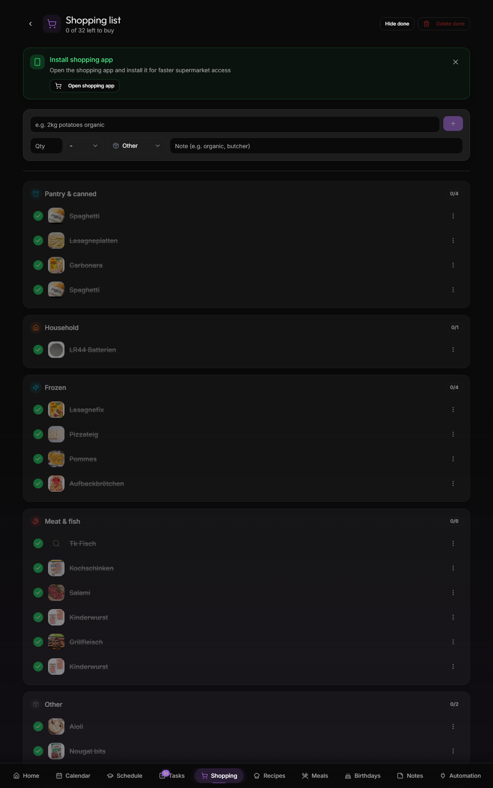
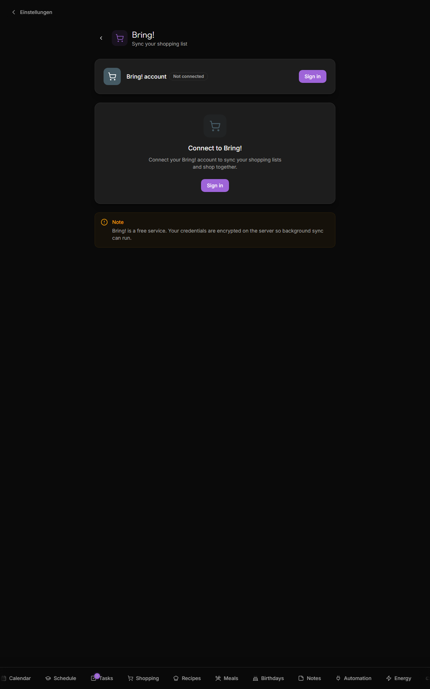

# Bring! shopping list

Two-way sync between Kinboard's shopping list and the [Bring!](https://www.getbring.com/) mobile app, so the kitchen-wall list stays in sync with what someone updates from the supermarket.

> TODO: shot showing the Bring sync indicator badge in the page header

## What it does

- Logs into your Bring! account with email + password
- Lists your Bring! lists; you pick the active one
- Auto-syncs every 2 minutes on the server (configurable)
- Two-way: items added in Kinboard appear in Bring!, items added in Bring! appear in Kinboard, and items bought on either side are ticked off on the other
- Optionally syncs Bring's category labels back into Kinboard

## What it does not

- Doesn't sync multiple Bring! lists at once — one active list per family
- No real-time sync (poll-based): a change made in the Bring! app shows up in Kinboard within about 2 minutes
- Doesn't sync the recipe-list integration that Bring! has

## Setup

### 1. Connect

1. Open Settings → Bring!
2. Click **Sign in**
3. Enter your Bring! email + password
4. **Sign in**

The access and refresh tokens are stored server-side only, in the `integration_secrets` table (key `bring_settings`) — never sent to the browser; only the server reads them when posting to the Bring! API. Non-secret profile fields (account email, name, default list) remain in the regular `settings` table. See [Security-and-Threat-Model → Integration credentials](Security-and-Threat-Model#integration-credentials).

### 2. Pick the active list

After connect, the dropdown shows all your Bring! lists. Pick one — that becomes Kinboard's primary shopping list.

### 3. Tweak sync settings

| Toggle | What |
|---|---|
| **Auto sync** | Poll Bring! every 2 minutes (default on) |
| **Two-way sync** | Push Kinboard changes back to Bring! (default on; turn off for one-way "Kinboard mirrors Bring!" mode) |
| **Sync categories** | Adopt Bring's category names instead of Kinboard's auto-detected ones (default on) |

## How the sync works

The Kinboard server reads your selected Bring! list every 2 minutes while **Auto sync** is on. It also reads it when someone opens the shopping page, and when you tap **Sync now** in Settings → Bring!. It does this even when no screen is open.

- **Added in the Bring! app**: the item shows up on Kinboard's shopping list. A catalogue item shows in the family's language ("Milk" on an English Kinboard), but Kinboard remembers its Bring! name ("Milch") and uses it when it talks to Bring!.
- **Bought in the Bring! app**: the item is ticked off in Kinboard.
- **Put back on the list in the Bring! app**: the ticked item in Kinboard is unticked again.
- **Added, ticked, unticked or deleted in Kinboard**: Bring! is told straight away from the shopping page. Anything that didn't reach Bring! (shop mode, an assistant, a phone that was offline, a failed push) is sent on the next sync.

Each item remembers whether it was ticked the last time the two lists agreed. That's how the sync tells "ticked in Kinboard" apart from "put back on the list in Bring!": the side that changed since then wins.

With **Two-way sync** off, Kinboard only mirrors Bring!. Nothing is pushed, and when the two lists disagree, Bring! wins. Items you add only in Kinboard stay on Kinboard's list.

The Bring! sign-in renews itself. If Bring! won't renew it (for example after you change your Bring! password), sign in again under Settings → Bring!.

## Disconnecting

Settings → Bring! → **Disconnect**. Local shopping list stays; just stops syncing.

## Troubleshooting

| Symptom | Likely cause |
|---|---|
| **Login failed** | Bring! sometimes rate-limits credential checks; wait 5 min. Still rejected after several correct attempts? Sign out and back in via the Bring! mobile app to confirm the credentials work, then retry |
| **Sync runs but new items don't appear** | The active list ID is stale (you deleted it in Bring!). Re-pick the list. |
| **Categories show in German when I switched to English** | The category names from Bring! are German because that's what Bring! sent. Disable **Sync categories** to use Kinboard's localized auto-detection. |
| **Kinboard's quantity (`2 × Apples`) shows as `2x Apples` in Bring!** | Bring's freeform `specification` field doesn't have a separate quantity. Kinboard packs `quantity + unit + name` into the name on push. |

## Related

- [Themes](Themes) — shopping category labels live under `shoppingCategories` in `messages/{en,de}.json`
- See [`webapp/src/lib/shopping-categories.ts`](https://github.com/svenger87/kinboard/blob/main/webapp/src/lib/shopping-categories.ts) for the keyword auto-detection
