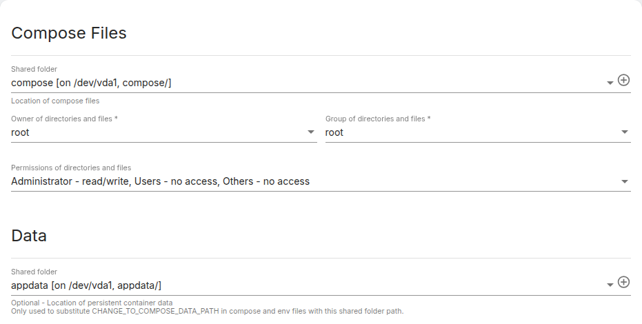
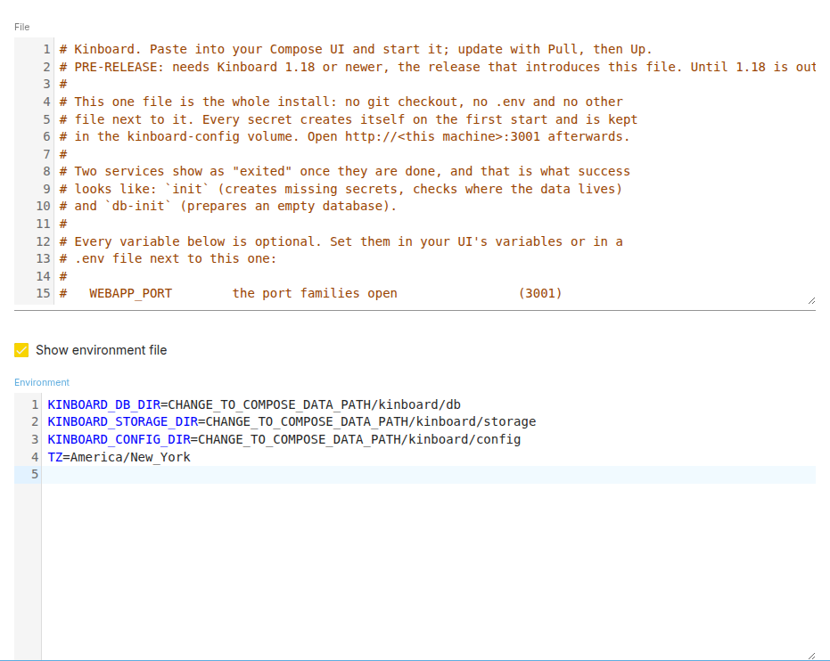
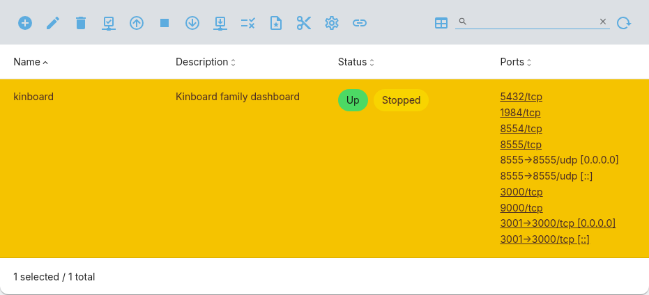

# Compose UIs

> **From Kinboard 1.18.** Everything on this page needs Kinboard 1.18 or
> newer, the first release with `compose.yml`. Until 1.18 is out, the download
> link below answers "Not Found", and an older image stops at the `init` step
> with *"This Kinboard image is older than 1.18 and can't run the one-file
> setup"*. Until then, install with [Quick-start](Quick-start).

Kinboard is one file, `compose.yml`. Paste it into the Compose tool you
already use, start it, and open the page. There is no git checkout, no
`setup.sh` and no terminal: the passwords and keys create themselves on the
first start. To update, press **Pull**, then **Up**.

This page has the general part first, then a section for each tool:
[OpenMediaVault](#openmediavault), [Portainer](#portainer),
[Unraid](#unraid-compose-manager), [Dockge](#dockge) and
[CasaOS](#casaos-should-work-not-supported).

## Get the file

Every release carries the file as a download:

```
https://github.com/svenger87/kinboard/releases/latest/download/compose.yml
```

Open that link, copy everything, and paste it into your tool. A particular
version's file is at `releases/download/v1.18.0/compose.yml` (with that
version's number). Don't take the file from the repository's main branch:
it can be ahead of the newest release.

Don't edit the file. Everything you might want to change is a variable
(below), so the next file can replace this one without losing anything.

## Where is my data?

**In three Docker volumes**, unless you choose folders:

| Volume | Holds |
|---|---|
| `kinboard-db` | the database: every family, calendar, list and setting |
| `kinboard-storage` | uploaded files: family photos, recipe pictures, vehicle images |
| `kinboard-config` | the install's secrets: the database password, the key that signs logins, the push notification keys |

Docker keeps volumes in its own folder, usually
`/var/lib/docker/volumes/<name>/_data`. To see where one is:

```bash
docker volume inspect kinboard-db --format '{{ .Mountpoint }}'
```

The names are fixed in the file, so renaming the stack in your tool, or
deleting it and pasting it again, keeps the same data. Removing the volumes
deletes it for good. Some tools offer that when you delete a stack ("remove
volumes"): say no unless you mean it.

**Folders instead.** If you'd rather have the data in a folder you can see
and back up with the rest of your NAS, set these three variables to absolute
paths **before the first start**:

```
KINBOARD_DB_DIR=/srv/appdata/kinboard/db
KINBOARD_STORAGE_DIR=/srv/appdata/kinboard/storage
KINBOARD_CONFIG_DIR=/srv/appdata/kinboard/config
```

Setting them later starts an empty Kinboard; the old data stays in the
volumes. Use absolute paths, starting with `/`: what a relative path like
`./data` means differs from tool to tool, and on Unraid it is the USB flash
drive.

Some places can't hold the database, and the `init` step refuses them with a
message that says why: a USB stick or other FAT/exFAT drive, a Windows or SMB
network share, a Windows drive under WSL (`/mnt/c`), a VirtualBox shared
folder, and a RAM disk (gone after a reboot).

**Whoever can read the data can read everything**, the secrets included.
Keep the folders, and the backups of them, private. And never point two
Kinboards, on one machine or two, at the same folders: two databases writing
into one folder destroy it.

## What a good start looks like

The first start takes a minute or two. Afterwards your tool shows:

| Container | State |
|---|---|
| `kinboard-init` | **exited**: it created the missing secrets and checked where the data lives |
| `kinboard-db-init` | **exited**: it prepared the empty database |
| `kinboard-db`, `kinboard-webapp` | running, healthy |
| `kinboard-rest`, `kinboard-go2rtc` | running |

The two "exited" ones are supposed to stop. That is what success looks like,
and they run again, briefly, at every start.

Then open `http://<your server's address>:3001` (or the port you chose). It
shows *"Welcome — let's set things up"*: name your family and this device,
and you get the six-character join code for the other devices. The rest is in
[Quick-start → Open the app](Quick-start#3-open-the-app).

**If `kinboard-init` exited with an error**, nothing else starts, and its log
says why: a refused data location (above), or a database password that
doesn't fit the database (see [Backups](#backups)). Your tool shows a
container's log when you click it.

## Variables

All optional. Each tool has a place for them, named in its section below;
in a terminal they go into a file called `.env` next to `compose.yml`.

| Variable | Default | What for |
|---|---|---|
| `WEBAPP_PORT` | `3001` | the port families open |
| `TZ` | `Europe/Berlin` | your time zone, such as `America/New_York` |
| `KINBOARD_TAG` | `latest` | `latest` follows releases; `next` follows release candidates; a version such as `1.18.0` stays on it |
| `KINBOARD_DB_DIR`, `KINBOARD_STORAGE_DIR`, `KINBOARD_CONFIG_DIR` | Docker volumes | absolute folders for the data, see [Where is my data?](#where-is-my-data) |
| `SITE_URL` | empty | the address Kinboard puts into links for other apps (the calendar feed). Empty uses the address you opened it at |
| `WEBRTC_LAN_IP` | empty | this server's LAN address, for cameras over WebRTC ([Cameras](Cameras)) |
| `PUID`, `PGID` | empty | the user and group that own the uploaded files, when they sit in a NAS folder: `99` and `100` on Unraid, usually `1000` and `1000` elsewhere |
| `INSTANCE_ADMIN_FAMILY_ID` | empty | on an install with several families, the one that sees the install's own notices (below) |
| `KINBOARD_IMAGE` | `ghcr.io/svenger87/kinboard` | the image without its tag, for a mirror |
| `KINBOARD_UPDATER_IMAGE` | `ghcr.io/svenger87/kinboard-updater` | the same for the automatic updater, which starts only with `COMPOSE_PROFILES=autoupdate` ([Automatic updates](#automatic-updates)) |

Eight more, `KINBOARD_POSTGRES_PASSWORD` and the other `KINBOARD_`-named
secrets in the file's header, are only for
[moving a git install to this file](#moving-a-git-install-to-this-file).
Leave them unset on a new install. They carry the `KINBOARD_` prefix so that a
`POSTGRES_PASSWORD` meant for another app, in a tool's shared variables
(OpenMediaVault's and Dockge's `global.env`), can never reach Kinboard.

## Updating: Pull, then Up

Press **Pull**, then **Up** (each tool's words are in its section). That is the
whole update. Everything a release changes ships in the image: the database
updates run when the new webapp starts, the scheduled jobs come with it, and
the secrets stay in their volume. `kinboard-init` and `kinboard-db-init` run
again and find nothing to do.

In a terminal, in the folder with `compose.yml`:

```bash
docker compose pull && docker compose up -d
```

`KINBOARD_TAG=latest` (or unset) moves to each new release; a version number
stays where it is until you change it.

The bottom of Settings says when a newer release is out, as *"Update
available"*. To have Kinboard update itself, see
[Automatic updates](#automatic-updates).

### Which version am I running?

The very bottom of **Settings** shows it. From a terminal, the version of the
image the running container was made from:

```bash
docker inspect kinboard-webapp --format '{{ index .Config.Labels "org.opencontainers.image.version" }}'
```

Still the old version after Pull and Up? See
[Self-hosting → Still the old version after updating](Self-hosting#still-the-old-version-after-updating).

### "Your compose file is older than this version of Kinboard expects"

Most releases change only the image. Now and then one needs a change in the
file too: a new version of the database or of PostgREST, or a new service.
The file says which revision it is (`KINBOARD_COMPOSE_REVISION`), and when the
image wants a newer one, Settings shows this notice under the version, with
the lines that changed, a link to what changed and a link to the current
file.

Kinboard keeps running meanwhile. To clear it, replace your file with the
current one ([Get the file](#get-the-file)) and press Up. Your variables stay
where they are, in your tool or in `.env`, so nothing of yours is lost.

The notice is shown to the install's own household only: on an install with
one family, that family; with several, the family whose id is in
`INSTANCE_ADMIN_FAMILY_ID`.

## Automatic updates

Off unless you turn it on. One variable does it:

```
COMPOSE_PROFILES=autoupdate
```

Put it with your other variables (each tool's section says where), then
press **Up** again. A seventh container appears, `kinboard-updater`. In a
terminal, either put the line into `.env` or run
`docker compose --profile autoupdate up -d`.

**What it does.** Two minutes after it starts, and then every 30 minutes, it
asks the registry whether the tag you follow (`KINBOARD_TAG`, `latest` by
default) has a newer Kinboard image. When it has:

1. it pulls the new image;
2. it checks that the new version fits your compose file (below);
3. it takes a backup and checks it: the database, the uploaded files and the
   config volume, the same three things as [Backups](#backups). No checked
   backup, no update;
4. it recreates only `kinboard-init`, `kinboard-db-init` and
   `kinboard-webapp`. The database, PostgREST and go2rtc keep running;
5. it waits up to 10 minutes for the new version to come up healthy and to
   pass a check of its database tables. If it doesn't, it goes back to the
   version that ran before, on its own, and skips the broken one until a
   newer one is published. The top of Settings then says
   *"The update to … didn't start, so Kinboard went back to …"*;
6. it writes one line per step into its log, and Settings shows
   *"Updated automatically to … on …"* under the version.

**The first check only looks.** It notes what runs and changes nothing; the
one after it is the first that can update.

**A version number never moves.** With `KINBOARD_TAG=1.18.0` the updater
never even asks the registry. If you change `KINBOARD_TAG` (back to `latest`,
say) and press Up, Up already did it; if you change it without Up, the next
check applies it, with the backup first.

**When the release needs a newer compose file.** The updater never edits
your file: it may hold your port and folders. When a new version needs a
newer file than yours (the
[revision](#your-compose-file-is-older-than-this-version-of-kinboard-expects)
differs), it installs nothing, keeps the current version running, and
Settings shows *"Your compose file is older than this version of Kinboard
expects"* under the version. Replace the file with the current one, keep your
variables, and press Up; the updater carries on from there.

**When the registry can't be reached**, or says it is busy (HTTP 429), the
check changes nothing and the next one waits longer: 30 minutes, then an
hour, two, up to six.

**What it leaves to you.** It only ever updates the Kinboard image. A new
version of the database, PostgREST or go2rtc comes with a new compose file,
which you start with Up yourself. It leaves the stack alone while you have
stopped the webapp. And it reads your settings from the same place your tool
does, the file and its variables (or `.env`): if you once started the stack
with a variable typed into a terminal instead, and the folders it would get
differ from the ones the containers have, it changes nothing and its log
says so. Press Up once from your tool and it carries on.

**Where the backups go:** into the Docker volume `kinboard-backups`, or, when
your files are in a folder, beside it (`…/kinboard/backups` next to
`…/kinboard/storage`). `KINBOARD_BACKUP_DIR` names another folder. The last
five are kept.

**Its log:** `docker logs kinboard-updater` (every tool shows a container's
log), and `updater/update.log` in the config volume or folder.

**The Docker socket.** To pull and recreate containers, the updater needs
Docker's socket, and whoever holds that controls the machine. It is the only
container in this file that gets it, and only when you turn automatic
updates on. It opens no port and takes no requests.

**To pause it**, add `KINBOARD_UPDATE_TICK=off` to your variables (read at
every check; no Up needed). **To remove it**, take `COMPOSE_PROFILES` out of
your variables and remove the container: `docker rm -f kinboard-updater`.

**Updating the updater itself:** Pull and Up, as for the rest. It never
replaces its own container while it runs.

**Which tools:** OpenMediaVault, Unraid's Compose Manager, Dockge and a
terminal keep `compose.yml` on the server's disk, and the updater reads it
there. **Portainer's web editor** keeps the file inside Portainer, where the
updater can't read it. There it works from the containers instead: it
replaces each Kinboard container with one that has exactly the same settings
(variables, volumes and folders, networks, ports, labels) and only the new
image, so Portainer still shows them in your stack and **Update the stack**
keeps working as before. The same goes for a stack whose compose file has
since been deleted. **CasaOS** is not supported.

Diun isn't needed. If you already run it, it can keep sending you a
notification; the updater doesn't depend on it.

The same updater keeps the [all-in-one image](All-in-one#automatic-updates)
up to date, started next to that one container.

## Backups

A complete backup is three things, and the third is easy to forget:

1. **the database**, as a dump;
2. **the uploaded files** (`kinboard-storage`): photos exist nowhere else;
3. **the config** (`kinboard-config`): the secrets. Without them a copied
   database can't be opened. `kinboard-init` refuses to start a database whose
   password file is missing, and says so. A dump restored into a new install
   works without them, but every device has to turn notifications on again.

None of the tools below can back up a volume on its own, so this needs a
terminal on the server. With the default volumes, into `/backups`:

```bash
mkdir -p /backups
docker exec kinboard-db pg_dump -U supabase_admin -F c postgres > /backups/kinboard-$(date +%F).pgdump
docker exec -i kinboard-db pg_restore -l < /backups/kinboard-$(date +%F).pgdump | head -3
docker run --rm -v kinboard-storage:/storage:ro -v /backups:/out --entrypoint sh supabase/postgres:15.14.1.159 \
  -c 'tar -czf /out/kinboard-storage-'"$(date +%F)"'.tar.gz -C /storage .'
docker run --rm -v kinboard-config:/config:ro -v /backups:/out --entrypoint sh supabase/postgres:15.14.1.159 \
  -c 'umask 077; tar --numeric-owner -czf /out/kinboard-config-'"$(date +%F)"'.tar.gz -C /config .'
```

The second line checks the dump: a good one prints `; Archive created at …`;
a broken one says `input file does not appear to be a valid archive`. The
`supabase/postgres` image is already on the server, the database runs on it.
The config archive holds every secret of the install: keep it where only you
can read it. Self-hosting → [Backups](Self-hosting#backups) explains each
detail of these lines.

With folders instead of volumes, archive `KINBOARD_STORAGE_DIR` and
`KINBOARD_CONFIG_DIR` the same way (as root, so owners and modes are kept),
and take the database as a dump all the same: copying the database folder
while it runs gives a backup that may not open.

### Restoring

Onto a new server, or after the volumes are gone:

1. **The config first, before the first start**, so Kinboard starts with its
   old secrets instead of making new ones:

   ```bash
   docker volume create kinboard-config
   docker run --rm -v kinboard-config:/config -v /backups:/in:ro --entrypoint sh supabase/postgres:15.14.1.159 \
     -c 'tar --numeric-owner -xzpf /in/kinboard-config-2026-12-01.tar.gz -C /config'
   ```

2. **Start the stack** (Up) and wait until Kinboard shows its welcome page.
   It is empty, but with the current tables.
3. **The database and the files**:

   ```bash
   docker exec -i kinboard-db psql -U supabase_admin -d postgres -c "TRUNCATE public.instance_settings, public.system_heartbeats"
   docker exec -i kinboard-db pg_restore -U supabase_admin -d postgres \
     --data-only --disable-triggers -n public < /backups/kinboard-2026-12-01.pgdump
   docker run --rm -v kinboard-storage:/storage -v /backups:/in:ro --entrypoint sh supabase/postgres:15.14.1.159 \
     -c 'tar -xzf /in/kinboard-storage-2026-12-01.tar.gz -C /storage'
   ```

4. **Restart the webapp** (`docker restart kinboard-webapp`), so it reads
   the restored settings, and reload the page.

A good restore prints nothing and exits 0. Self-hosting →
[Restoring one](Self-hosting#restoring-one) says why each flag is there.

## OpenMediaVault

*Tested on OpenMediaVault 8.7 with the Compose plugin
(`openmediavault-compose`) 8.2.7, Docker 29.10 and Compose 5.8, in November
2026. OMV 7's Compose plugin has the same Files page but wasn't tested.*

**Once, before the first file.** Install the plugin under *System →
Plugins* (`openmediavault-compose`; it comes from omv-extras, which OMV's
install script sets up). Then *Services → Compose → Settings*:



- **Compose Files → Shared folder:** a shared folder of its own on a data
  disk, such as one called `compose`. The plugin keeps each file in a folder
  of the same name inside it (`…/compose/kinboard/`) and owns that folder:
  it rewrites what it put there and replaces any `.env` in it. Never pick a
  folder that holds a git install of Kinboard, see
  [below](#a-git-install-and-the-compose-plugin).
- **Data → Shared folder:** optional, such as one called `appdata`. The
  plugin then puts that folder's path wherever the file or its variables say
  `CHANGE_TO_COMPOSE_DATA_PATH`, which saves typing the disk's long name.
- **Save**, and apply the yellow *Pending configuration changes* banner. If
  the Docker info at the bottom of the page is empty, **Reinstall Docker**
  installs it.

**Paste.** *Services → Compose → Files*, **+**, **Add**. Name `kinboard`,
paste the file into **File**, tick **Show environment file** and put the
variables into **Environment**, one `NAME=value` per line. **Save**.



Keeping the data in folders on the data disk is the usual choice on OMV:
they sit with the rest of your shares and OMV's own backup tools see them.
With a **Data** shared folder set:

```
KINBOARD_DB_DIR=CHANGE_TO_COMPOSE_DATA_PATH/kinboard/db
KINBOARD_STORAGE_DIR=CHANGE_TO_COMPOSE_DATA_PATH/kinboard/storage
KINBOARD_CONFIG_DIR=CHANGE_TO_COMPOSE_DATA_PATH/kinboard/config
TZ=America/New_York
```

Without one, write the full path, as *Storage → Shared Folders* shows it
under **Absolute Path** (`/srv/dev-disk-by-uuid-…/appdata/kinboard/db`).
Without these three lines the data goes into Docker volumes, in OMV's Docker
storage folder (`/var/lib/docker` on the system disk unless you changed it
under **Docker storage**).

**Start.** Select `kinboard` in the list and press **Up** (the buttons' names
show when you hover over them). The first start pulls the images and takes a
minute or two; the output ends with `Container kinboard-webapp Started`.



The **Status** column shows **Up** and **Stopped** side by side. Stopped is
`kinboard-init` and `kinboard-db-init`, which exit once they're done; that is
how it should look. *Services → Compose → Containers* lists them as
`exited`, and the other four as `running`.

**Update:** select `kinboard`, **Pull**, then **Up**. Only `kinboard-init`,
`kinboard-db-init` and `kinboard-webapp` are recreated; the database keeps
running.

**Automatic updates:** select `kinboard`, edit it (the pencil), add
`COMPOSE_PROFILES=autoupdate` to **Environment**, **Save**, then **Up**.
`kinboard-updater` appears in the list. It reads the same files OMV starts
the stack with, from the disk (`kinboard.yml`, `compose.override.yml`,
`global.env` and `kinboard.env`), and puts its backups next to the storage
folder (`…/appdata/kinboard/backups`). After it has updated, the next **Up**
you press recreates the three Kinboard containers once more, a few seconds'
restart: the updater's Compose and OMV's write their settings slightly
differently. Nothing changes.

**Good to know:**

- *Services → Compose → Files* has a button for the shared `global.env`.
  Its variables reach every file, Kinboard's too; a file's own
  **Environment** wins over them. That is harmless: Kinboard reads only the names in the
  table above, and its secrets have `KINBOARD_` names that no other app uses.
- The plugin keeps a file's variables in OMV's own settings as well as in
  `…/compose/kinboard/kinboard.env`, readable by root only. Moving a git
  install puts its passwords there; take them out once it has started
  ([below](#moving-a-git-install-to-this-file)).
- The database folder shows an owner like `dhcpcd` in *Shared Folders* and
  `ls -l`. That's the database's own user inside its container (uid 101),
  which on Debian happens to have that name. Leave it, and leave
  `kinboard/db` out of OMV's permission resets.

### A git install and the Compose plugin

Run a git install (`git clone`, `setup.sh`, `./start.sh`) *or* the Compose
plugin, never both on one Kinboard. To switch, [move the git install to this
file](#moving-a-git-install-to-this-file).

What goes wrong otherwise, both seen on OMV 8 with plugin 8.2.7:

- **`webapp/docker/.env` disappears.** When the plugin's **Compose Files**
  folder is one that contains `webapp/docker` (`/kinboard/webapp`, say) and it
  has a file named `docker` (the name **Import** gives the git folder), the
  plugin owns `webapp/docker`. Each time OMV applies its compose settings it
  deletes `.env` there and links it to its own `docker.env`; **Delete** on
  that file removes `.env` for good. `.env` holds the install's passwords.
  [Troubleshooting](Troubleshooting#startsh-up-says-env-is-missing-or-env-keeps-disappearing)
  says how to get going again.
- **OMV's Up and Down act on the git install.** A git install runs as the
  Compose project `docker`, after its folder, and a file imported from it is
  called `docker` too. That is one project, so **Down** on OMV's copy stops
  your Kinboard, and **Up** recreates its containers from OMV's copy of the
  folder, where `./data` is new and empty.

## Portainer

Portainer CE, a stack from the **Web editor**.

- **Paste:** *Stacks → + Add stack*, name `kinboard`, **Web editor**, paste.
  Variables under **Environment variables**, **+ Add an environment
  variable** for each. **Deploy the stack**.
- **Data:** the volumes appear under *Volumes*. Use only absolute paths for
  folders: in Portainer CE's web editor, a relative path ends up inside
  Portainer's own data, not next to anything you can find.
- **Update:** open the stack, **Editor**, **Update the stack**, with **Re-pull
  image and redeploy** switched on. Or turn on
  [automatic updates](#automatic-updates): add the variable
  `COMPOSE_PROFILES` = `autoupdate` and **Update the stack** once.
- **With automatic updates:** the updater can't read the web editor's file, so
  it replaces each Kinboard container (`kinboard-init`, `kinboard-db-init`,
  `kinboard-webapp`) with one that has the same settings and the new image.
  The stack page keeps listing all of them, and the stack's own file still
  says what you pasted: with `KINBOARD_TAG` left at `latest` (or `next`) that
  is exactly what runs, and a later **Update the stack** finds nothing to
  change. A pinned version (`KINBOARD_TAG=1.18.0`) is never updated
  automatically; you change the pin in the editor yourself. While a
  container is being replaced, the old one shows for a moment as
  `kinboard-webapp-before-update`; it goes once the new version is healthy,
  and comes back under its own name if it isn't. Best not to press **Update
  the stack** in those few minutes: Portainer then removes the set-aside
  containers, and the updater keeps whatever Portainer started rather than
  going back (its log says so).
- **Version:** *Containers → kinboard-webapp* shows the image and its tag;
  the version itself is at the bottom of Kinboard's Settings.

## Unraid (Compose Manager)

The **Docker Compose Manager** plugin, from *Apps*.

- **Paste:** *Docker* tab, at the bottom **Add New Stack**, name `kinboard`.
  Then the stack's gear icon, **Edit Stack → Compose File**: paste, **Save
  Changes**. **Edit Stack → ENV File** for the variables.
- **Variables you need here:**

  ```
  KINBOARD_DB_DIR=/mnt/user/appdata/kinboard/db
  KINBOARD_STORAGE_DIR=/mnt/user/appdata/kinboard/storage
  KINBOARD_CONFIG_DIR=/mnt/user/appdata/kinboard/config
  PUID=99
  PGID=100
  ```

  The plugin keeps its stacks on the USB flash drive
  (`/boot/config/plugins/compose.manager/projects`), so a relative path would
  put the database there; `kinboard-init` refuses that (*"PostgreSQL can't
  keep its data on a FAT filesystem"*). Docker volumes would work, but on
  Unraid they live inside the Docker vDisk (`docker.img`), which is out of
  sight and gone when the vDisk is recreated. `appdata` is where Unraid
  expects container data, and its backup tools look there.
- **Start:** **Compose Up**.
- **Update:** **Update Stack** (it pulls, then starts). For
  [automatic updates](#automatic-updates), `COMPOSE_PROFILES=autoupdate` in
  the **ENV File**.

## Dockge

- **Paste:** **+ Compose**, stack name `kinboard`, paste into the compose
  editor. Variables go into the `.env` editor beside it. **Deploy**.
- **Data:** the volumes; the stack's own folder is `/opt/stacks/kinboard`
  (Dockge's stacks folder). Absolute paths for folders here too.
- **Update:** **Update** (it pulls, then starts). For
  [automatic updates](#automatic-updates), `COMPOSE_PROFILES=autoupdate` in
  the `.env` editor.

As with OpenMediaVault, Dockge's `global.env` reaches every stack, and that
is harmless.

## CasaOS (should work, not supported)

Nobody has run Kinboard on CasaOS yet, so this section is what we expect from
reading CasaOS's code, not something we have tried. Reports welcome.

CasaOS's import seems to skip a variable's default (`${WEBAPP_PORT:-3001}`
would not become 3001), so give it a file with every value already filled in.
On any machine with Docker, put `compose.yml` and a `.env` with your choices
in a folder called `kinboard` (the folder's name becomes the app's), and run
there:

```bash
docker compose config > kinboard-casaos.yml
```

Import `kinboard-casaos.yml` as a custom app (the **+** in the app list,
**Install a customized app**, **Import**). Keep the data in Docker volumes,
the default, and don't use relative paths: CasaOS seems to put those into a
temporary folder.

CasaOS appears to have no update for imported apps. Until someone confirms
otherwise, update from a terminal: `docker compose pull && docker compose up
-d` in the folder CasaOS keeps the app in.

## Behind Traefik

The git install's Traefik overlay works with this file too. In a UI, paste its
labels into the `webapp` service instead, and add Traefik's network:

```yaml
  webapp:
    # … everything that is already there, then:
    labels:
      - "traefik.enable=true"
      - "traefik.http.routers.kinboard-webapp.rule=Host(`kinboard.example.com`)"
      - "traefik.http.routers.kinboard-webapp.entrypoints=websecure"
      - "traefik.http.routers.kinboard-webapp.tls.certresolver=letsencrypt"
      - "traefik.http.services.kinboard-webapp.loadbalancer.server.url=http://kinboard-webapp:3000"
    networks:
      - kinboard
      - traefik
```

and at the bottom, under the file's `networks:`, next to `kinboard: {}`:

```yaml
  traefik:
    name: proxy
    external: true
```

Replace the domain, the entrypoint, the resolver and the network name
(`proxy`) with your Traefik's. This is the one change to the file itself, so
carry it over when you replace the file. [Self-hosting → Behind
Traefik](Self-hosting#behind-traefik) has the Traefik side.

## Moving a git install to this file

Optional, and nothing does it on its own: an install made with `git clone`
and `setup.sh` keeps working exactly as before, 1.18 included. Move only if
you want to manage Kinboard from a Compose UI. It needs Kinboard 1.18 or
newer.

**With the automatic update** (the Diun overlay): step 3 stops Diun and
its webhook along with the rest. After the move, turn on this file's own
[automatic updates](#automatic-updates) instead.

What changes for a moved install:

- The scheduled jobs run inside the webapp; the `kinboard-cron` container is
  gone.
- The database port (5432) and go2rtc's port 1984 are no longer published
  on the host. Nothing in Kinboard needs them.
- go2rtc's own example streams from `go2rtc.yaml` (`hikvision`, `amcrest`)
  are not there. Add those cameras in Settings by their URL, as any other
  ([Cameras](Cameras)).
- Other overlays from `COMPOSE_FILES` don't come along. Traefik's labels go
  into the file, as above.
- The Compose project is now your tool's name for the file (`kinboard`), not
  `docker`, the git folder's name.

The steps, in a terminal on the server:

1. **Take a backup** ([Self-hosting → Backups](Self-hosting#backups)).
2. **Note your values.** In `webapp/docker` of the git folder:

   ```bash
   grep -E '^(DATA_DIR|WEBAPP_PORT|TZ|KINBOARD_TAG|SITE_URL|PUID|PGID|INSTANCE_ADMIN_FAMILY_ID)=' .env
   for k in POSTGRES_PASSWORD JWT_SECRET CRON_SECRET PRESENCE_SENSOR_TOKEN VAPID_PUBLIC_KEY VAPID_PRIVATE_KEY ANON_KEY SERVICE_ROLE_KEY; do
     v=$(grep -E "^$k=" .env | tail -n1 | cut -d= -f2- | tr -d '"'); [ -n "$v" ] && echo "KINBOARD_$k=$v"
   done
   ```

   The second command prints the secrets already under their new names, ready
   to paste in step 4. They are the install's passwords: don't post them
   anywhere. `DATA_DIR` may be relative; the default `./data` means
   `<git folder>/webapp/docker/data`. `SITE_URL=http://localhost:3001` is
   `setup.sh`'s placeholder and not worth carrying over.
3. **Stop the old stack:** `./start.sh down`. The containers go; the data
   stays. Both stacks use the same container names, so the new one can't
   start while the old one runs. If your Compose UI already has a file for
   this Kinboard (OpenMediaVault's **Import** makes one called `docker`),
   delete it now, while the stack is stopped, and on OpenMediaVault point
   **Compose Files** at a folder outside the git folder
   ([why](#a-git-install-and-the-compose-plugin)). When that folder contains
   the git folder, deleting the file removes `webapp/docker/.env`; you have
   the values from step 2 and the backup.
4. **Set the new stack's variables** (in your tool, or in `.env` next to
   `compose.yml`), with the folders as absolute paths and each secret under
   its `KINBOARD_` name:

   ```
   KINBOARD_DB_DIR=/path/to/kinboard/webapp/docker/data/db
   KINBOARD_STORAGE_DIR=/path/to/kinboard/webapp/docker/data/storage
   KINBOARD_CONFIG_DIR=/path/to/kinboard/webapp/docker/data/config
   WEBAPP_PORT=3001
   KINBOARD_POSTGRES_PASSWORD=<POSTGRES_PASSWORD>
   KINBOARD_JWT_SECRET=<JWT_SECRET>
   KINBOARD_CRON_SECRET=<CRON_SECRET>
   KINBOARD_PRESENCE_SENSOR_TOKEN=<PRESENCE_SENSOR_TOKEN>
   KINBOARD_VAPID_PUBLIC_KEY=<VAPID_PUBLIC_KEY>
   KINBOARD_VAPID_PRIVATE_KEY=<VAPID_PRIVATE_KEY>
   KINBOARD_ANON_KEY=<ANON_KEY>
   KINBOARD_SERVICE_ROLE_KEY=<SERVICE_ROLE_KEY>
   ```

   plus `TZ`, `KINBOARD_TAG`, `SITE_URL`, `PUID`, `PGID` and
   `INSTANCE_ADMIN_FAMILY_ID` where you had them. `config` is a new folder;
   `kinboard-init` creates it. Leave out a secret your `.env` didn't have
   (an older install may have no presence token, or no VAPID keys when
   `setup.sh` found no Node.js); it is then generated.
5. **Up.** `kinboard-init`'s log has one line per secret, `taken from .env`.
   The database opens with its old password, devices stay signed in, and push
   keeps working, because the keys are the same.
6. **Check:** the version at the bottom of Settings, your family's data, a
   join from a new device, a test notification.

Afterwards the `KINBOARD_` secret lines can stay (they win over the stored
files) or go (the files in `config/secrets/` hold the same values now). In a
UI that keeps variables in its own settings, OpenMediaVault for one, take
them out, **Save** and **Up**: nothing changes, and the passwords are no
longer in its settings.

Leave the git folder alone, and don't delete it while the folders above
point into it: `data/` is now the new stack's. `./start.sh up` there would
fail on the container names. To make sure it isn't run from habit, move
`webapp/docker/.env` somewhere private, next to your backup.

If `kinboard-init` refuses with *"POSTGRES_PASSWORD in the environment … differs
from the stored secrets/postgres_password"*, the config folder already held a
different password: check `KINBOARD_CONFIG_DIR` points at a new, empty
`config` folder.
