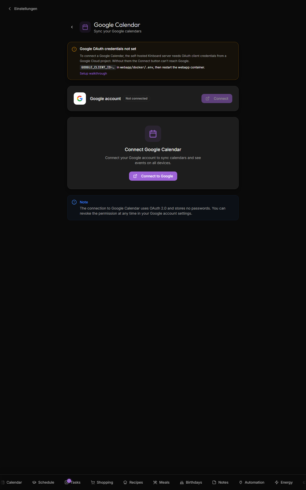
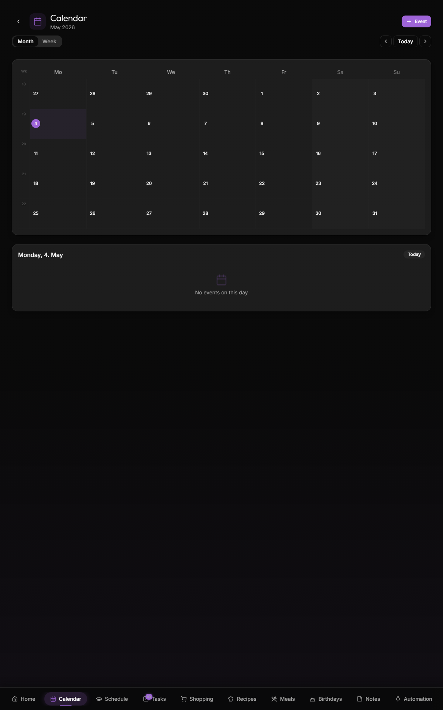

# Google Calendar

**Two-way sync** of selected Google calendars into the dashboard view. Events created or edited in Kinboard get pushed back to Google; events created in Google flow into Kinboard at the next sync interval. Per-event mapping rules let you assign events to specific family members based on title patterns.

> Not on Google? [CalDAV](CalDAV) gives you the same two-way sync against Nextcloud, Radicale, Fastmail, iCloud and friends — with a username and password instead of a Google Cloud project. The mapping rules below are shared by both providers.



## What it does

- OAuth into your Google account, list calendars, let you pick which ones to sync
- Pull events into `public.events` on a schedule (default 15 min) or on demand
- Push events created/edited/deleted in Kinboard back to the chosen Google calendar
- Assign events to specific people via mapping rules ("starts with `Emma:`" → assign to Emma)
- Show holidays + waste-collection calendars distinctly (badges per type)

## What it does not

- Doesn't write to Google calendars Google itself marks read-only (subscribed public calendars, calendars shared to you with view-only permission). Those round-trip is suppressed; you'll see an error toast if you try.
- Doesn't sync attendees, attachments, or recurring-event exceptions beyond the basics.
- Doesn't dedupe across overlapping subscribed calendars (if two of your enabled calendars include the same event, it shows twice).

## Setup

### 1. Create a Google Cloud OAuth client

You need a project with the Google Calendar API enabled. The free tier is plenty.

1. Open https://console.cloud.google.com/projectcreate
2. Create a project named `kinboard` (or whatever).
3. Enable the **Google Calendar API**: APIs & Services → Library → search "Google Calendar API" → Enable.
4. Create OAuth credentials: APIs & Services → Credentials → Create Credentials → **OAuth client ID** → Application type **Web application**.
5. **Authorized redirect URI:** open Kinboard → **Settings → Google Calendar**. The card *Redirect URI for Google Cloud* shows the exact address this install will send; copy it and paste it here unchanged. It is the address you opened Kinboard on plus `/api/google/callback`, e.g. `https://kinboard.example.com/api/google/callback`.
   - Google accepts only **https with a domain name**, or **`http://localhost`**. A LAN address such as `http://192.168.1.20:3001` or `http://server.local:3001` is refused in Cloud Console. You only have to connect **once**, so either open Kinboard on the server itself at `http://localhost:3001` (or through an SSH tunnel: `ssh -L 3001:localhost:3001 you@server`, then `http://localhost:3001` on your own computer), register that address and connect there, or use your https address. After that every screen syncs, whatever address it uses.
6. Save the **Client ID** and **Client secret**.

### 2. Enter it in Settings

Open **Settings → Google Calendar** and paste the Client ID and Client secret into **Google OAuth client**, then **Save**. They are stored for your family on the server; the secret is never shown again in full.

**Or for the whole install, in `webapp/docker/.env`:**

```
GOOGLE_CLIENT_ID=<paste from Cloud Console>
GOOGLE_CLIENT_SECRET=<paste from Cloud Console>
```

A family's own client wins over the server's. A connection belongs to the client it was made with, so after changing the client, connect again.

`GOOGLE_REDIRECT_URI` is optional: leave it out and the redirect URI follows the address you open Kinboard on. Set it only to pin one address for every screen (then the Settings card says so).

After changing `.env`, recreate the webapp (`cd webapp/docker && ./start.sh up`); a restart does not load changed variables.

### 3. Connect from the app

1. Open Settings → Google Calendar
2. Click **Connect**
3. Sign in to Google in the popup, grant calendar read access
4. Pick which calendars to sync (toggle them on)
5. Optional: assign each calendar to a specific person (the per-row "Person" select)
6. Optional: mark a calendar as a **holidays calendar** (party-popper icon) or **waste-pickup calendar** (recycle icon) — these get special widget treatment

### 4. Verify

The Settings page shows **Last sync**. Click **Sync now** to trigger an immediate fetch. New events appear on the dashboard within a few seconds.



## Mapping rules

If you have a single shared family calendar but want events auto-assigned to people based on title patterns, use mapping rules:

| Match type | Example | What it matches |
|---|---|---|
| `contains` | `Emma` | Any event title containing "Emma" (case-sensitive substring) |
| `starts_with` | `Mama:` | Title begins with "Mama:" |
| `ends_with` | `(Papa)` | Title ends with "(Papa)" |
| `regex` | `^[A-Z][a-z]+ —` | Custom regex |

Rules are evaluated in priority order; first match wins. Higher-priority rules override lower. Test rules with the **Test** button — it runs them against the next 30 days of synced events and shows which person each would be assigned to.

## Auto-sync

Enable the **Automatic synchronization** toggle to have the cron container poll Google every 15 minutes. Configured in `webapp/docker/ofelia.ini`. When auto-sync errors (token expired, network blip, etc.), the badge on the Settings page surfaces it.

## Disconnecting

Settings → Google Calendar → **Disconnect**. Local synced events stay in the database; they just stop being refreshed. To remove the synced events too, delete the calendar rows in `/settings/google` first.

The OAuth tokens — stored server-side only in `integration_secrets`, not the `settings` table every screen of the family can read (see [Security-and-Threat-Model](Security-and-Threat-Model#integration-credentials)) — are deleted on disconnect.

## Troubleshooting

| Symptom | Likely cause |
|---|---|
| **"Error 400: redirect_uri_mismatch"** on Google's page | The address registered in Cloud Console isn't the one Kinboard sent. Copy it from Settings → Google Calendar and paste it unchanged, including `http`/`https`, the port and no trailing slash. Before 1.17, Docker installs always sent `http://localhost:3000/api/google/callback` (#503). |
| **No calendars listed** after connect | API not enabled in Cloud Console; or your account has zero calendars |
| **Cloud Console refuses the redirect URI** | Google takes only https with a domain name, or `http://localhost`. Connect once from `http://localhost:<port>` (see step 5) or via your https address. |
| **Auto-sync stops after 6 months** | Google's refresh tokens expire if unused. Click **Sync now** once to refresh, or revoke + reconnect |
| **"Reconnect" banner appears, sync stopped** | Google rejected the stored authorization (`invalid_grant` — consent revoked, password changed, or the refresh token expired from long disuse). Click **Reconnect** in Settings → Google Calendar to re-authorize; the banner clears automatically on the next successful sync. |

## Related

- [Architecture](Architecture#database-schema) — `calendars` and `events` tables
- [Notifications](Notifications) — event-based calendar reminders
