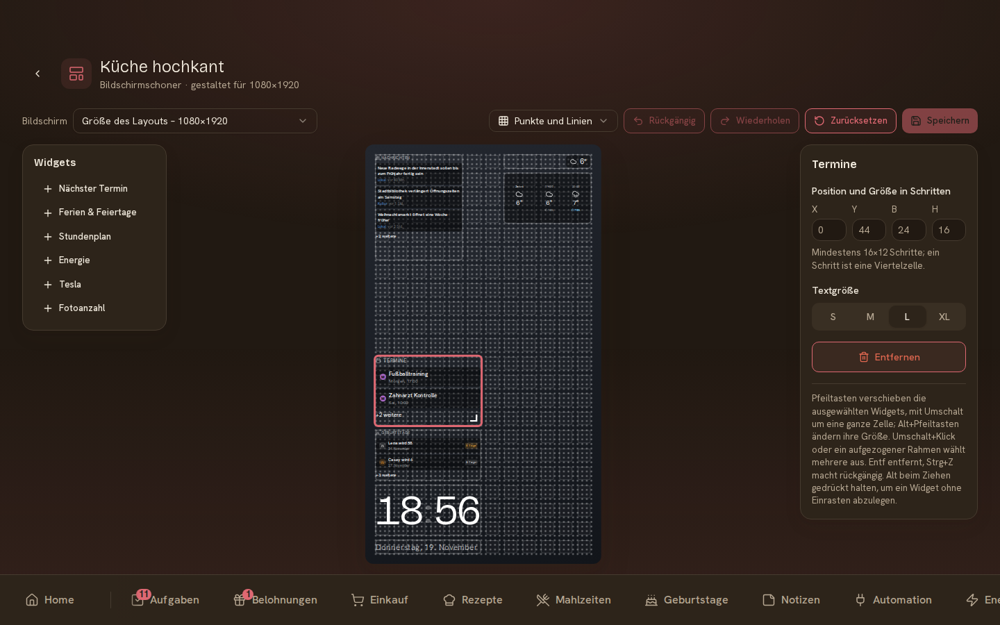
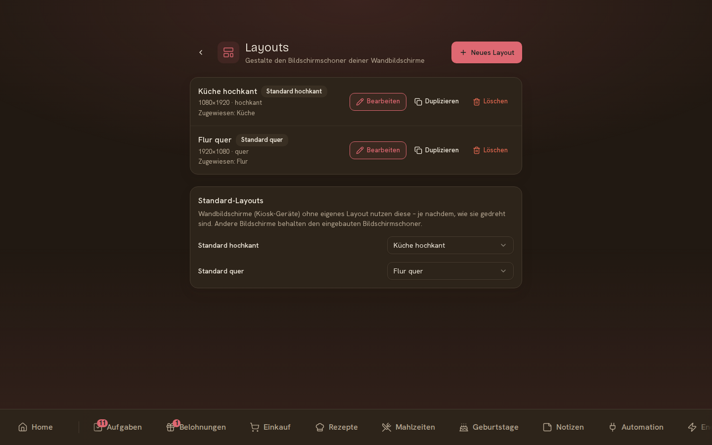

# Layouts

A layout is your own arrangement of a wall screen's [screensaver](Screensaver): which widgets it shows, where, how large, and at what text size. You draw it once for a screen size, assign it to one or more screens, and those screens show it instead of the built-in screensaver.

Nothing changes for a family that never creates a layout: every screen keeps the built-in screensaver until a layout is assigned to it, or set as a default for wall screens.

## What a layout is

- **Named and owned by the family** — "Küche hochkant", "Flur quer". Every device of the family can see it; only a parent with the [settings PIN](Security-and-Threat-Model#the-settings-pin) can change it.
- **Made for one screen size** — a width and a height in CSS pixels, the size the page is drawn at on that screen. Settings → Devices shows the size each screen reports, including the browser's scaling (a 1080×1920 panel at Windows 150% draws pages at 720×1280).
- **Drawn on a grid** — 48 columns, each step a quarter of a square cell. The 24px gap sits only between boxes, and the screen's edges are 48px away. Widgets snap to steps, so two widgets can never overlap and the spacing stays even. Layouts made before the finer grid look exactly as they did.
- **Shared where you want** — several screens can use the same layout; editing it changes all of them.

## Creating a layout

**Settings → Layouts → New layout.** Give it a name and pick the screen it is for:

- **Your screens** — each of the family's devices that has reported its size ("Küche — 1080×1920").
- **Common sizes** — Full HD portrait and landscape, each at 100% and 150% scaling, and a tablet both ways.
- **Custom size…** — any width and height. A layout needs a page at least 600px wide with room for six rows of cells; the form says so when a size is too small.

A new layout starts from the built-in screensaver's arrangement for that shape, so you rearrange rather than start from an empty screen. **Duplicate** makes a copy with the same arrangement and size, not assigned to any screen; **Delete** asks first and names the screens that go back to the built-in screensaver (or to the default layout).

## The editor

The editor shows the screen at its true proportions, scaled to fit, with the real widgets and your family's real data: your events, birthdays, weather and news, as the wall will show them.

- **Move** a widget by dragging it; it snaps to the grid (and to other boxes, see Tools). A widget cannot be dropped on top of another.
- **Resize** it by dragging its corner. Each widget has a minimum size (the inspector shows it); it will not go smaller.
- **Palette** (left) — the widgets not yet on the screen: clock, date, next event, weather now, forecast, events, birthdays, holidays, news, lessons, energy, Tesla and the photo count. Click one to add it in the first free space; each widget appears once.
- **Inspector** (right) — the selected widget's position and size (X, Y, W, H, in steps; the minimum size is shown), its **text size** (Small, Medium, Large, Extra large) and **Remove**.
- **Undo / Redo** — every change in this session, also with Ctrl+Z and Ctrl+Shift+Z (or Ctrl+Y).
- **Keyboard** — see the table under Tools; Delete removes the selection, Escape deselects.
- **Reset** puts the built-in arrangement back (undoable until you leave the page); **Save** writes the layout, and the screens using it update within a second or two.

Unsaved changes survive the settings PIN locking in the middle of an edit. If someone else saved the same layout meanwhile, Save says so and offers to reload rather than overwrite their work.

### Tools

- **Grid** — the toolbar shows it as dots and lines, as lines, or not at all; the choice is remembered in this browser.
- **Guides** — while you drag or resize, a box snaps within one step of another box's edge or centre, or of the screen's centre, and a line shows what it lined up with. Hold Alt (Option) while dragging to drop exactly where you let go.
- **Several boxes** — Shift+click adds to the selection, or drag a frame on empty canvas. With several selected you can align left, right, top, bottom or centre, distribute horizontally or vertically (the outermost boxes stay), or give them the same width or height (as the first selected). Delete removes all of them.
- **Exact values** — the inspector has X, Y, W and H as number fields, in steps. A value that doesn't fit is refused with the reason.
- **Refused moves** — a move or command that can't be done says why and changes nothing. Each command is one undo.

| Keys | Does |
| --- | --- |
| Arrow | Move one step |
| Shift + arrow | Move a whole cell (four steps) |
| Alt + arrow | Resize one step |
| Alt + Shift + arrow | Resize a whole cell |
| Delete | Remove the selected boxes |
| Escape | Deselect |
| Ctrl+Z / Ctrl+Shift+Z | Undo / redo |

After an update to Kinboard, reload screens and editors that were open: an editor still running the old version can't save (it shows an error) and changes not saved before the update are lost. If Kinboard itself detects that the page is out of date, it says so ("Kinboard was updated…") and offers to reload.

### How widgets fill their box

- **Lists** (events, birthdays, holidays, news, lessons) show as many whole entries as fit and end with "+3 more" for the rest. A taller box shows more entries; the text stays at its size.
- **Single values** (clock, date, next event, weather now, photo count) grow to fill their box.
- **The forecast** shows as many forecast slots as the box is wide enough for. **Energy** and **Tesla** can be as small as half a cell high: in a flat box their figures sit side by side, otherwise they are stacked. They use the box's text size and get smaller only when that does not fit.

Text sizes follow the screen's short side, so a layout looks the same on every screen of its shape.

A widget whose feature is not set up — no weather service, the Tesla plugin switched off, no lessons — shows a hint in the editor and an empty space on the screen. Nothing moves to fill it.

## Assigning it to screens

- **Per screen** — Settings → Devices has a **Layout** picker under each device: *Built-in* or one of your layouts.
- **Defaults for wall screens** — Settings → Layouts → *Default layouts* has a **portrait default** and a **landscape default**. A wall screen (a device marked as a kiosk) without a layout of its own uses the default for the way it is turned. Each picker only offers layouts of its orientation.

Which layout a screen shows, in order:

1. its own layout, if the layout's orientation matches the way the screen is turned;
2. the family's default for that orientation — wall screens (kiosks) only;
3. the built-in screensaver.

So a tablet turned on its side moves from its own portrait layout to the landscape default, and back when turned again. Devices that are not kiosks (a laptop, a phone) only ever use a layout assigned to them directly.

Settings → Devices says what each screen will show: "Uses the default layout “Küche hochkant”", or a warning when a screen's shape is far from its layout's ("Made for 1080×1920 — this screen is 1280×800"). Settings → Screensaver notes which screens use a layout, since its own switches (news, forecast, number of events and birthdays, *Large clock and events*) apply only to screens without one.

## On screens of other sizes

A layout drawn for 1080×1920 also runs on a 720×1280 screen (the same panel at 150%): positions and sizes are stored in grid steps, so it scales. When the other screen has a different number of rows — a tablet at 800×1280, say — the rows are scaled proportionally, minimum sizes win, and a widget that no longer fits is left out. Settings → Devices lists what a screen leaves out ("Not shown on this screen: Birthdays").

In the editor, the screen picker previews the layout on any other size. The preview is read-only and names what does not fit. To arrange the layout for that size, **Make a copy for this size**: the copy is a new layout of that size, redrawn from the saved one. Widgets that lost their place are moved into free cells first, shrinking toward their minimum, and only those that still do not fit are left out; the new editor lists them ("Not on this size: Birthdays") so you can make room and add them back from the palette.

## What stays the same

A layout arranges the widgets. Everything around them is unchanged:

- the **photo** in the background, its rotation and its credit;
- the **weather effects** (Settings → Screensaver → *Weather effects*);
- the children's **creatures** along the bottom (Settings → Creatures);
- the **festival** decorations and visitors (Settings → Design → Festivals);
- the **night** view: during the family's bedtime, with *Night* on, the dim clock on black replaces the layout too;
- a **message** sent to the screen still takes over the whole screen, and a touch still wakes it.

The "touch to unlock" hint is not shown over a designed layout; the layout owns the screen.

## What's not supported (yet)

- **Phones and narrow screens keep the built-in screensaver.** Below 600px wide (or with room for fewer than six rows) the grid's cells would be a few pixels wide, so a layout assigned to such a screen is not drawn there.
- **Home.** Layouts arrange the screensaver only. Arranging Home the same way follows in a later release; until then Home is set up under Settings → Widgets.
- **Pixel-exact placement, colours and fonts.** Widgets snap to the grid; the text size is the one style choice per widget.
- **Layouts that change with the time of day**, beyond the night view.

## Related

- [Screensaver](Screensaver) — the built-in screensaver, photos, presence and night
- [People and devices](People-and-Devices) — marking a screen as a kiosk, and the size each screen reports
- [Security-and-Threat-Model](Security-and-Threat-Model#the-settings-pin) — the settings PIN that guards layouts
