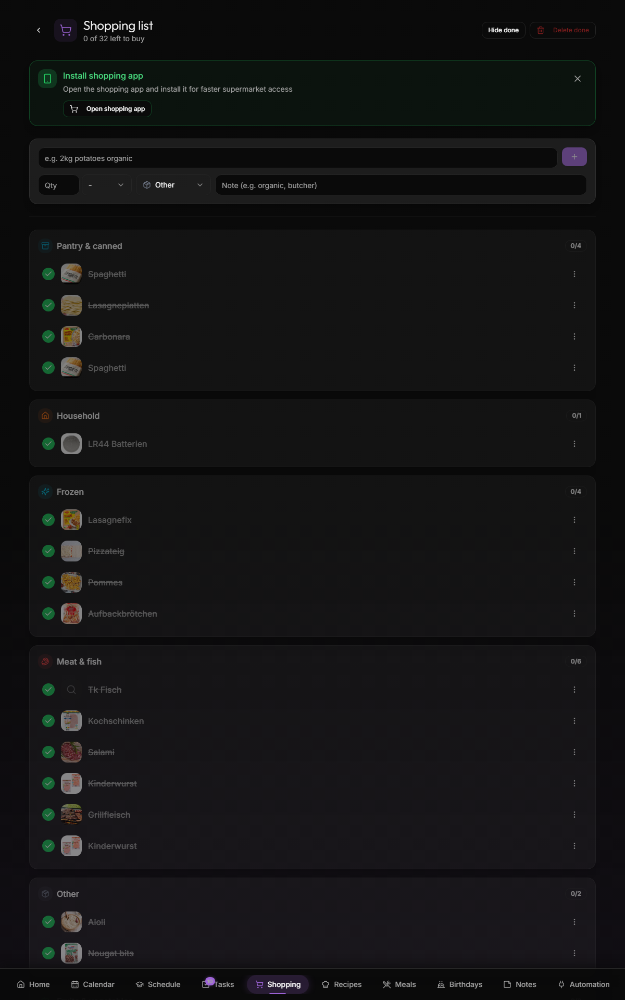

# Shopping list

The `/shopping` page — collaborative real-time shopping list with cross-device sync and **offline support** out of the box. No third-party account required.

For families that already use [Bring!](https://www.getbring.com/), the Bring integration is **optional** — connect it and Kinboard will keep its list and your Bring list in two-way sync. But the built-in shopping list works fully on its own and is the recommended path for new users (one less account, one less moving part).



> TODO: offline-mode banner variant

There's also a legacy `/einkaufen` route for German URL muscle-memory; both render the same page.

## Built-in cross-device sync + offline

The built-in list runs entirely on your Kinboard instance — no external service:

- **Real-time across devices** — adding "milk" on the kitchen kiosk shows up on every family phone within ~1 s, and vice versa
- **Offline-tolerant** — runs as a PWA with a service worker + IndexedDB queue. When the supermarket has no cell reception (basement Lidl, anyone?), you can still add items, tap items off the list, and check items as bought. Changes queue locally and replay automatically when the device gets connectivity back.
- **Conflict-free** — items have stable IDs; two phones checking off the same item simultaneously both succeed without "lost update" weirdness

## Standalone shopping-list PWA

Kinboard ships with a **dedicated PWA just for the shopping list**, separate from the main Kinboard PWA. Installing it gives you:

- A **separate home-screen icon** (shopping logo, distinct from the main Kinboard icon)
- A **scoped install** — opens directly to the shopping list every time, no nav drawer, no other surfaces
- Its own splash screen and green theme color (`#22c55e`)
- A "Quick add item" home-screen shortcut (long-press the icon on Android) that jumps straight to the add field
- Full offline support out of the gate

This is the **recommended phone install** for any family member whose only need on their phone is the shopping list. Power user pattern: parents who do the shopping install just the shopping PWA, kids install the full Kinboard PWA.

### How to install the shopping PWA

When you open `/shopping` on a phone, a green banner appears after ~2 seconds offering install. Tap it:

- **iOS**: it deep-links to `/einkaufen` (the route with the shopping-only manifest), then walk through Safari Share → Add to Home Screen. The icon that lands on your home screen is the shopping logo, scoped to the shopping page only.
- **Android**: same deep-link, then accept the browser's install prompt. Browser auto-detects the shopping manifest at the `/einkaufen` URL and installs the scoped PWA.

> Why is the dedicated manifest served from `/einkaufen`? Historic — that's the original German URL where this feature shipped. Both `/einkaufen` and `/shopping` render the same UI, but only `/einkaufen` exposes the shopping-specific manifest. The install prompt automatically routes you there.

If you've **already installed the main Kinboard PWA** and want the shopping one too: open `/einkaufen` directly in your browser (not via the existing PWA icon), then install — both icons coexist on the home screen.

### Main Kinboard PWA vs shopping-only PWA

| | Main Kinboard PWA | Shopping-only PWA |
|---|---|---|
| Install from | Anywhere in Kinboard | `/einkaufen` (banner deep-links you there) |
| Manifest | `/manifest.json` | `/manifest-shopping.json` |
| Icon | Kinboard logo | Shopping logo |
| Scope | Whole app | Just the shopping page |
| Theme color | Per monthly theme | Green (`#22c55e`) |
| Push notifications | All types | All types (same origin = same permission) |
| Offline shopping | Yes | Yes |
| Best for | Daily-driver phone, kitchen kiosk, kids | "I just want the shopping list on my phone" |

Both can be installed on the same device.

For the general PWA install how-to (iOS quirks, Android variations), see [Notifications → Installing as a PWA](Notifications#installing-as-a-pwa).

## Adding items

The text input at the top is a smart adder:

- **Just type a name** → category auto-detected from the keyword list (e.g. "Apfel" → Obst & Gemüse)
- **Quantity prefix** → `2 Milch` adds two milks, `500g Butter` parses the unit
- **Multiple items at once** → comma-separated: `Brot, Butter, Käse`
- **From history** → starts a dropdown of recent items as you type; tap to re-add

Items appear instantly for everyone in the family thanks to real-time sync — a mom adding "milk" from her phone while shopping shows up on the kitchen wall in <1 s.

### By barcode

The barcode button (next to the microphone on the shopping list, left of the input on the phone page) adds a product by its barcode: the empty package in your hand goes straight on the list.

- **Camera:** hold the barcode in front of it. Browsers allow the camera only on **https** addresses or **localhost**; on a plain-http LAN address (`http://192.168.1.20:3001`) the dialog says so and offers the photo instead.
- **Photo:** take a picture of the barcode. Works on every address, plain http included.
- **Type it:** the digits under the barcode. A wrong digit is caught by the check digit before anything is looked up.

Each add leaves the scanner open for the next package. Retail barcodes are read: EAN-13, EAN-8, UPC-A and UPC-E. The phone's own barcode reader is used where it has one (Chrome and Edge on Android); Safari on iPhone and iPad and Firefox read it with [ZXing](https://github.com/zxing-js/library), loaded only then.

**Where the product comes from.** First your family's own catalog, then [Open Food Facts](https://world.openfoodfacts.org), an open, worldwide, crowd-sourced product database (millions of products from well over 150 countries; best covered in Europe, good in North America, thinner elsewhere). Products that aren't food come from its sister databases: [Open Beauty Facts](https://world.openbeautyfacts.org) (shampoo, toothpaste), [Open Pet Food Facts](https://world.openpetfoodfacts.org) and [Open Products Facts](https://world.openproductsfacts.org) (everything else). Names come in the family's language where the database has one, else in the product's own; brand and size go into the item's note, and the category follows the product's.

**When no database knows it** (a local bakery's bread, a store brand), you name it once. It goes on the list, and your family's catalog remembers the barcode, so the next scan finds it under that name. The dialog also links to Open Food Facts, should you want to add it there for everyone.

The lookup is made by your Kinboard server and sends Open Food Facts only the barcode, nothing about your family. The product's picture is then loaded by the phone from Open Food Facts' image server, as for other catalog suggestions.

## Categories

Items are grouped by category for supermarket-aisle order. The default categories:

| Category | Examples |
|---|---|
| Fruits & vegetables | Apples, salad, tomatoes |
| Dairy | Milk, cheese, yogurt |
| Bakery | Bread, rolls, croissants |
| Meat & fish | Chicken, beef, salmon |
| Drinks | Water, juice, beer, wine |
| Frozen | Pizza, ice cream |
| Breakfast & spreads | Cereal, jam, peanut butter |
| Sweets & snacks | Chocolate, chips, cookies |
| Pantry & canned | Pasta, rice, canned tomato |
| Household | Detergent, toilet paper |
| Drugstore | Toothpaste, shampoo |
| Pet supplies | Cat food, dog treats |
| Other | Anything that doesn't match |

Auto-categorization uses a German keyword list (~2000 entries) — works great in German, partial in English. To override an item's category, tap the item, change category in the dropdown.

[Localized labels](Themes) in EN/DE/FR.

## Item lifecycle

```
[+ Add]  →  unchecked  →  ☑ checked  →  stays until manually cleared
```

- Newly added items appear at the top of their category
- Tap the checkbox to mark as bought (item moves to the bottom, struck through)
- Checked items don't disappear on their own — there's no auto-remove timer. Clear them via the "Clear checked" button whenever you're ready; the "Hide checked" toggle in the header lets you hide them from view in the meantime without deleting anything
- Deleting a single item (checked or not) shows an "Undo" toast that restores it exactly as it was

## Bring! sync (optional, off by default)

You don't need Bring at all — the built-in shopping list works fully on its own. Connect it only if your family already uses [Bring!](Bring) as their phone shopping app; the two-way sync mechanics live on that page. The sync indicator in the page header shows last-sync time + status — tap to force-sync.

## Quick-add chips

Below the input field, the most-frequently-added items show as one-tap chips. The list adapts to your family's habits:

- **First 30 days**: shows a default chip set (milk, bread, butter, eggs, ...)
- **After 30 days**: shows your top 12 by add-frequency
- Per-family — kids' shopping habits influence the chips alongside adults'

## Item catalog memory

Kinboard remembers items per family in `public.item_catalog`. When you add "Müsli," Kinboard offers the suggestion next time without recomputing the keyword match. Edits to category / unit / preferred brand stick across re-additions.

## Notifications

Shopping list pushes (per [Notifications](Notifications)):

- **New item added** → notify other devices (configurable per device)
- **Reminder for open list** → notify if the list is non-empty for >24 h (configurable)

Tweak in **Settings → Notifications**.

## Patterns that work well

- **The wall display is the family checklist.** Mom adds milk while cooking; the kid checks it off when he opens the fridge and sees only one bottle left.
- **Phone PWA in the supermarket**: install the Kinboard PWA on your phone, walk the aisles ticking items as you grab them. Works offline, syncs as soon as you're back in range.
- **Bring on-top (only if you already use it)**: families that prefer Bring's mature mobile UX can connect it and have items round-trip both ways. Otherwise stick with the built-in.
- **Recipe-driven shopping**: from a recipe page, tap "Add ingredients to shopping list" — adds all required ingredients in one go (with quantities).

## What's not supported

- **Multiple lists per family.** One active list. Bring! integration mirrors only one Bring list.
- **Per-store partitioning.** No "Lidl items" vs "Rewe items" split — items just have categories.
- **Recurring shopping items.** No "auto re-add coffee every Monday." Workaround: keep the favorite chips.
- **Photo of the receipt.** Out of scope.

## Related

- [Bring](Bring) — full Bring! sync setup
- [Recipes](Recipes) — adding recipe ingredients to the list
- [Notifications](Notifications) — push setup for shopping events
