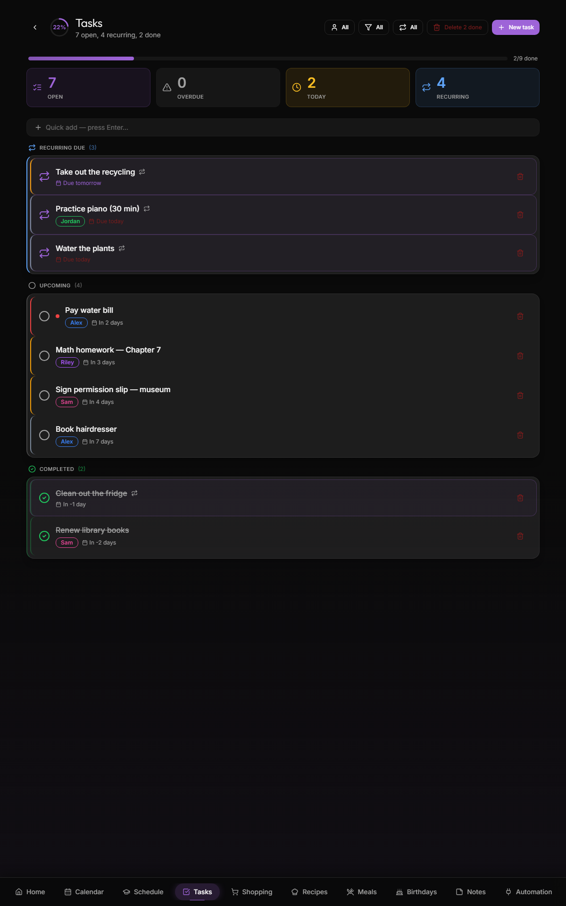

# Tasks & todos

The `/todos` page — family-shared task list with priorities, due dates, and per-person assignments.



## Adding a task

Top of the page: a single-line input. Just type and hit enter:

```
Schedule dentist appointment
```

The task lands in the family's todo list, unassigned, due today. Tweak from the task card:

- **Person** — assign to one family member or leave family-wide
- **Due date** — defaults to today; tap to pick another
- **Priority** — low / normal / high / urgent (visual badge)
- **Notes** — multi-line free text for context
- **Show under Events on Home** — tick it to pick this task for the Events widget on the Home screen: it is listed on the day it is due (a repeating task on its next day). A task with no date, or an overdue one, is listed under Today until it is done. Only the ticked tasks are listed there. **Settings → Calendar → Treat tasks as events** lists every task in the Week overview and the calendar's day list, but not in the Events widget.

## List sections

Tasks are auto-grouped:

| Section | What |
|---|---|
| **Overdue** | Past due, not yet completed |
| **Today** | Due today |
| **This week** | Due in next 7 days |
| **Later** | Due >7 days out |
| **No date** | Tasks without a due date |
| **Completed** | Last 7 days of completed (auto-archive after) |

Within each section, sort by priority then due-date.

## Per-person filter

The filter chips at the top of the page narrow by person:

- **All** (default)
- **Family** (no person assigned)
- One chip per family member

Useful for quickly checking what's on Dad's plate vs the kids' plate.

## Priority

Four levels with visual indicators:

| Priority | Indicator | When to use |
|---|---|---|
| **Urgent** | 🔴 red border | Time-sensitive, blocks others |
| **High** | 🟠 orange dot | Important, not blocking |
| **Normal** | (none) | Default |
| **Low** | (faded) | Nice-to-have |

Priority drives sort order within sections. Urgent tasks float to the top of "Overdue" and "Today" sections.

## Reminders

Two notification flows for todos (configurable per device in [Settings → Notifications](Notifications)):

1. **New task assigned to you** — push instantly when someone creates/assigns a task to your person row (your device opted in)
2. **Daily 8:00 AM digest** — summary of pending tasks due today, sent to all subscribed devices

The 8 AM job runs in the cron container. Quiet hours respected.

## Marking done

Tap the circle on the task card → it moves to the **Completed** section, struck through. Auto-archives after 7 days.

**Who did it?** Ticking a task worth points, on the tasks page or the Tasks widget on Home, asks who did it. Tap a name, and that person gets the points: when Jonas takes Mira's turn at the dishes, Jonas earns them and his creature cheers. Whoever the task is for is listed first. Close the dialog to leave the task unticked. A parent who did it earns nobody points. A repeating task shows the name next to *Last*. Tasks without points tick in one tap, as before. A tick from Home Assistant or an assistant doesn't ask: the points go to the assignee or to whoever's turn it was.

If you tap done by accident, tap the checkmark again within ~5 seconds to undo. Deleting a task outright (not just marking it done) shows a separate "Undo" toast that restores it exactly as it was.

## Persistence

- Tasks live in `public.todos`
- Real-time sync — completing on a phone removes the task from the kitchen-wall display in <1 s
- Completed tasks stay in the DB after archive (for "did we do that thing last week" queries) — 30-day retention before hard-delete

## Patterns that work well

- **The chore wall.** Each family member sees their assigned chores; ticking off generates a satisfying visual.
- **Project tracker.** Tag everything related to a renovation as "high" priority and use Notes for shared context.
- **Doctor's reminders.** Assign to the doctor-coordinating parent with a future due date — daily 8 AM digest surfaces it the morning of.

## What's not supported

- **Sub-tasks / nesting.** One level only.
- **Recurring tasks.** "Take out trash every Tuesday" — workaround is to keep a recurring Google Calendar event or re-add manually.
- **Time-of-day reminders** (e.g. "remind at 5 PM today"). Daily-digest is the only time-bound push.
- **Task templates.** Want this, not yet.

## Related

- [Notifications](Notifications) — push setup
- [Dashboard](Dashboard) — tasks widget on the home screen
